```{r, echo=FALSE}
library(tidyverse)
library(colorspace)
library(patchwork)
knitr::opts_chunk$set(fig.align="center")

undev1 <- read_csv('data/hdi3.csv', na = '..') |> select(-hdi_rank)

undev2 <- read_csv('data/hdi2.csv', na = '..') |> 
    select(-one_of(c('hdi_rank', 'maternal_mortality')))

undev <- left_join(undev1, undev2, by = 'country')
```

### Week 3: Explore, visually

- Why visualize?

- Elements of statistical graphics

- Principles of effective visualization

## This week: data visualization {.smaller}

**Objective**: introduce the uses, types, anatomy, and construction of statistical graphics. 

- **Why visualize?**
    - No one likes reading a table
    - Exploratory graphics: discovery
    - Presentation graphics: communication

- **Statistical graphics**
    - Elements: axes, geometric objects, aesthetic attributes, and text
    - Construction: mapping data to graphical elements
    - Common statistical graphics

- **Principles of effective visualization**
    - Tips and advice

## Why visualize?

- Tables are not effective ways of preventing simple stories

- Exploratory graphics: discovery

- Presentation graphics: communication

## Notice your reaction

<center>{width="75%"}</center>

(There's a reaason that tables are usually put in appendices.)

## Types of graphics

There is a broad distinction between:

- **exploratory graphics**, which are intended to be seen only by analysts; and

- **presentation graphics**, which are intended to be seen by an audience.

## Types of Graphics

- Exploratory graphics are made quickly in large volumes, and usually not formatted too carefully. Think of them like the pages of a sketchbook.

- Presentation graphics are made with more attention to detail. 

- The two are not mutually exclusive: an especially helpful exploratory graphic is often worth developing as a presentation graphic to help an audience understand 'what the data look like'.

## Infographics

<center>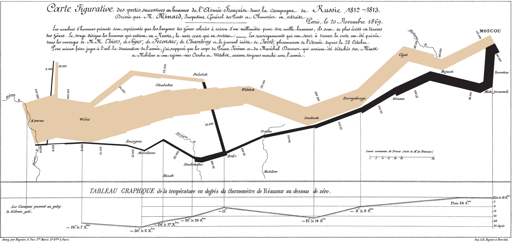{out.width="60%"}</center>

## Infographics

- Usually much more complex, meant to engage with for a long time

- Dense with information presented in multiple ways

- Works of art

## Common statistical graphics and their uses {.smaller}

Some examples:

- **Single-variable graphics** are used to visualize distributions.
    - Box plot
    - Histogram
    - Density 

- **Two-variable graphics** are used to visualize relationships.
    - Scatterplot
    - Bar plot
    - Line plot
    - 2D density / Contour plots

- **Multi-variable graphics** are used to visualize spatial data, matrices, and a collection of other data types.

## The Good, The Bad and The Ugly

<center>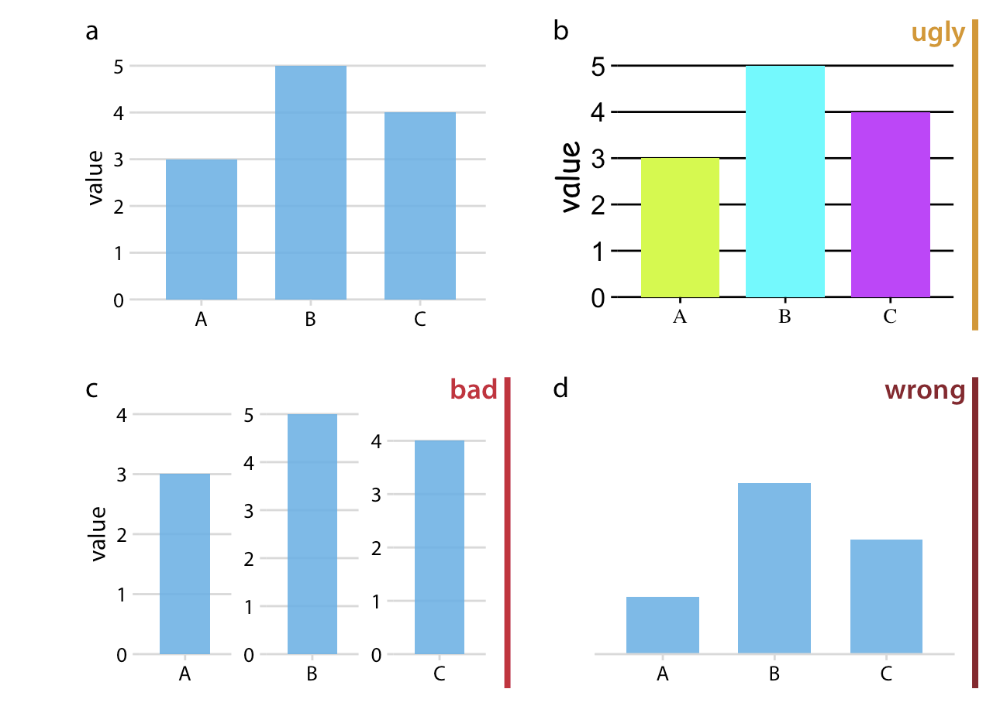{width=70%}</center>

Course reference: [The Fundamentals of Data Visualization](https://clauswilke.com/dataviz/)

# Elements of statistical graphics

## Aesthetics

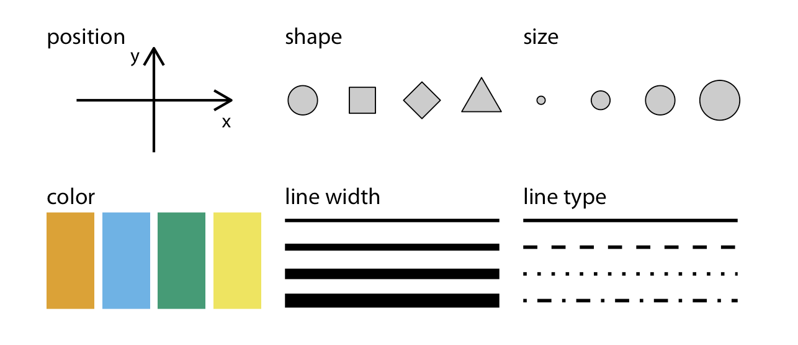{width="50%"}

## Aesthetic attributes

Aesthetic attributes (or 'aesthetics' for short) will mean qualities of geometric objects, like color.

Primary aesthetics in graphics are:

- Shape (for points)

- Color (outline color and fill colro)

- Point size / linewidth

- Opacity

## Text

Text is used to:

- label axes, 

- label objects

- create legends

- set titles.

Creates the story -- text gives a plot its meaning!

## Statistical graphics are mappings

Statistical graphics are **mappings** of dataframe columns to geometric objects and aesthetic attributes. For a simple example, consider the following time series of Cuba's population by year:

```{r, echo=FALSE}
# Read and reshape the population data
pop <- read_csv('data/population.csv', locale = locale(encoding = 'latin1')) %>%
  pivot_longer(
    cols = -c(`Country Name`, `Country Code`),
    names_to = "Year",
    values_to = "Population"
  ) |> 
  mutate(Year = ymd(paste0(Year, "-01-01")))
```

```{r, echo=TRUE}
#| output-location: slide

# Create the population plot
pop_plot <- pop %>%
  filter(`Country Code` == 'CUB') %>%
  ggplot(aes(x = Year, y = Population)) +
  geom_line() +
  labs(title = "Population of Cuba") +
  theme_bw(base_size=16)

pop_plot
```


```{r, echo=FALSE}
# Read and process country info
countryinfo <- read_csv('data/country-info.csv') %>%
  rename(
    `Country Code` = `alpha-3`,
    Region = region
  ) %>%
  select(`Country Code`, Region)

# Create population by region dataset
popregion <- inner_join(
  countryinfo,
  pop,
  by = "Country Code") |> 
  drop_na() %>%
  mutate(Region = as.factor(Region)) %>%
  group_by(Region, Year) %>%
  summarise(Population = sum(Population)) %>%
  ungroup()
```

## Statistical graphics are mappings

In the plot:

- population $\longrightarrow$ y-coordinate;

- year $\longrightarrow$ x-coordinate;

- the line connects the rows of the dataframe.

## Mapping variables to aesthetics

Now consider aggregated populations by global region and year:

```{r}
print(popregion |> arrange(Year), n=10)
```

## Mapping variables to aesthetics

```{r, echo=TRUE}
#| output-location: slide
# Create the plot
popregion_plot <- popregion |> 
  ggplot(aes(x = Year, y = Population, color = Region)) +
  geom_line(alpha = 1) +
  theme_bw()

popregion_plot
```

## Mapping variables to aesthetics

In this plot:

- population $\longrightarrow$ y

- year $\longrightarrow$ x

- region $\longrightarrow$ color

## Types of Variables

<center>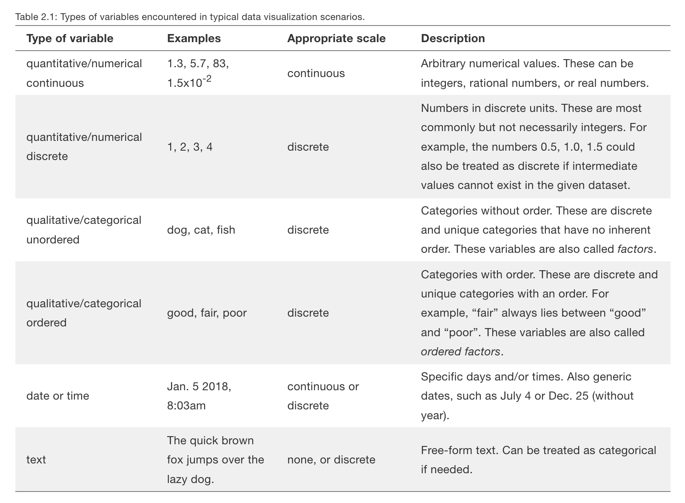{width=70%}</center>


<!-- ## Box  -->

<!--  -->

<!-- ## Statistical graphics -->

<!-- - Elements: axes, geometric objects, aesthetic attributes, and text -->

<!-- - Construction: mapping data to graphical elements -->

<!-- - Common statistical graphics -->

<!-- ## Elements of statistical graphics -->

<!-- Statistical graphics are actually quite simple. They consist of the following four elements: -->

<!-- 1. **Axes** -->
<!--     - References for all other graphical elements. -->
<!-- 2. **Geometric objects** -->
<!--     - Points, lines, curves, filled regions, etc. -->
<!-- 3. **Aesthetic attributes** -->
<!--     - Color, shape, size, opacity/transparency. -->
<!-- 4. **Text** -->
<!--     - Labels, legends, and titles. -->

## A grammar of graphics

```{r, eval=FALSE, echo=TRUE}
ggplot(data = <DATA>) + 
  <GEOM_FUNCTION>(mapping = aes(<MAPPINGS>))
```

A ``ggplot` consists of 

- data (the input)

- _at least_ one `geom_` function

- mappings for each `geom_`

# Common statistical graphics

## Single-variable graphics: boxplot

Single-variable graphics are used to display the distribution of values of a single variable.

**Boxplots** show the spread, center, and skewness of values.

```{r, echo=TRUE}
#| output-location: slide
pop_boxplot <- pop |> 
  filter(Year == "1970-01-01") %>%
  ggplot(aes(x = Population)) +
  geom_boxplot(fill="gray") +
  scale_x_log10() +
  labs(title = "National populations in 1970") +
  theme_bw()
pop_boxplot

```

## Single-variable graphics: histogram

**Histograms** show the relative frequencies of values of a single variable.

One can see spread, center, skewness, and outliers, but _**also shape**_. 

```{r, echo=TRUE}
#| output-location: fragment
# Histogram
pop_histogram <- pop %>%
  filter(Year == "1970-01-01") %>%
  ggplot(aes(x = log10(Population))) +
  geom_histogram(bins=50) +
  labs(title = "National populations in 1970") +
  theme_bw()
pop_histogram
```

## Single-variable graphics

**Not necessarily limited to univariate data.**

For example, we could make one boxplot for each year and show the distributions of national populations for each year:

```{r, echo=TRUE}
#| output-location: slide

lincoln_weather <- ggridges::lincoln_weather

# Boxplot
temp_boxplot <- lincoln_weather |> 
  mutate(date = ymd(CST), month=as.factor(month(date))) |>
  ggplot(aes(x=month, y=`Max Temperature [F]`)) + 
  geom_boxplot() + theme_bw()
temp_boxplot


```

## Single-variable graphics

```{r, echo=TRUE}
#| output-location: slide

interval_plot <- lincoln_weather |> 
  mutate(date = ymd(CST), month=as.factor(month(date))) |>
  ggplot(aes(x=month, y=`Max Temperature [F]`)) + 
  ggdist::stat_dotsinterval() + theme_bw()
interval_plot

```

## Two-variable graphics: scatterplot

Scatterplots display relationships between two variables.

The pattern of scatter shows that life expectancy generally increases with GDP per capita.

## Two-variable graphics: scatterplot

```{r, echo=TRUE}
#| output-location: slide
gdp_per_cap <- read_csv("data/lab3-data.csv")

gdp_per_cap |> 
  ggplot(aes(x=log(`GDP per capita`), y=All)) + 
  geom_point() + theme_bw(base_size=16) + ylab("Life Expectancy")
```

## Two-variable graphics: line plot

Line plots display trajectories by connecting rows in a dataframe. 

These can represent trends, time courses, or paths traveled.

```{r, echo=TRUE}
#| output-location: slide
pop |> filter(`Country Name` == "Ukraine") |>
  ggplot(aes(x=Year, y=Population)) + 
  geom_line() + theme_bw(base_size=16)
```

## Two-variable graphics: bar plot

Bar plots usually depict the relationship between the magnitude of one variable and another.

For instance:

```{r, echo=TRUE}
#| output-location: slide
country_region <- inner_join(countryinfo, pop, by = "Country Code") 
country_region |>
  filter(Region == "Oceania") |>
  ggplot(aes(y=Population, x=`Country Name`)) + 
  geom_col() 
```

## An improved bar plot

```{r, echo=TRUE}
#| output-location: slide
country_region |>
  filter(Region == "Oceania", Year == "2019-01-01") |>
  mutate(`Country Name` = as.factor(`Country Name`)) |>
  mutate(`Country Name` = fct_reorder(`Country Name`, Population)) |>
  ggplot(aes(y=log(Population), x=`Country Name`)) + 
  geom_col() + 
  coord_flip() 
```

<!-- ```{r, echo=TRUE} -->
<!-- inner_join(countryinfo, pop, -->
<!--            by = "Country Code") |> -->
<!--   filter(Region == "Oceania") |> -->
<!--   ggplot(aes(y=log10(Population), x=`Country Name`)) +  -->
<!--   geom_col() +  -->
<!--   coord_flip() -->
<!-- ``` -->

## Multi-variable plots

```{r, echo=FALSE}
country_data <- undev |> 
  left_join(pop |> inner_join(countryinfo,
                              pop, by = "Country Code"), 
            join_by(country == `Country Name`))
```

```{r, echo=TRUE}
#| output-location: slide
country_data |> ggplot() +
  geom_point(aes(x=labor_participation_women, 
                 y=gender_inequality,
                 size=total_pop, 
                 col=Region)) +
  theme_bw()   
```

## Multi-variable plots

In the plot:

- population $\rightarrow$ size of the point

- women labor participation $\rightarrow$ x-coordinate;

- gender inequality $\rightarrow$ y-coordinate;

- color $\rightarrow$ region

## Multi-variable plots

Shape files for geopgraphy:

```{r, echo=FALSE}
## Get's shape file for Africa
africa_shape <- rnaturalearth::ne_countries(continent="Africa", 
                                     scale = "medium", 
                                     returnclass = "sf") 
africa_data <- left_join(africa_shape, undev, by = join_by(name_en == country))

africa_data |> select(name_en, parliament_pct_women)
```

```{r, echo=TRUE}
#| output-location: slide
africa_data |> 
  ggplot() + geom_sf(aes(fill = parliament_pct_women)) +
    scale_fill_viridis_c(option = "plasma", trans = "sqrt") + theme_void()
```

# Color


## Color in computers


How do we tell a machine our favorite color?


Colors on a computer are stored as numeric instructions for how much Red, Green, and Blue (RGB) light to emit. For a computer, a color is fundamentally a triplet:


$$(R, G, B), \quad R,G,B \in [0,255]$$


<center>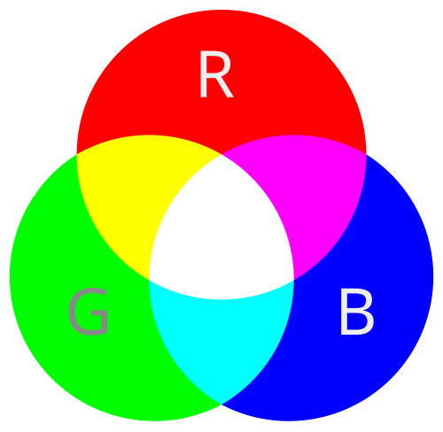{width="30%"}</center>


When $R = G = B = 255$, all three channels max out and we get **white**. This differs from mixing three paint colors, which gives black (or a very dark brown).


## RGB mixer


What color do you think `rgb(0, 54, 96)` is? Each channel takes a value between $0$ and $255$.


$$R = 0, \quad G = 54, \quad B = 96$$


. . .


The "Numerical representations" section of the [RGB color model](https://en.wikipedia.org/wiki/RGB_color_model) Wikipedia page has an interactive mixer you can play with.


## Exercise


What about `rgb(254, 188, 17)`? A lot of red and green, very little blue.


. . .


This is the [signature UCSB gold](https://brand.ucsb.edu/visual-identity/color)!


<center>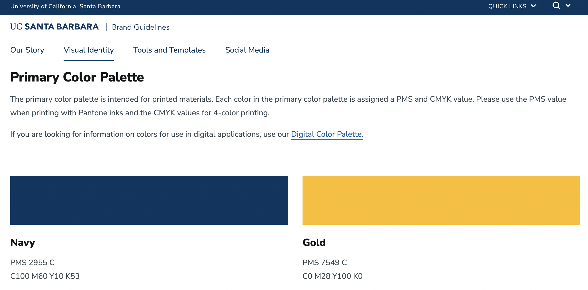{width="50%"}</center>

<center>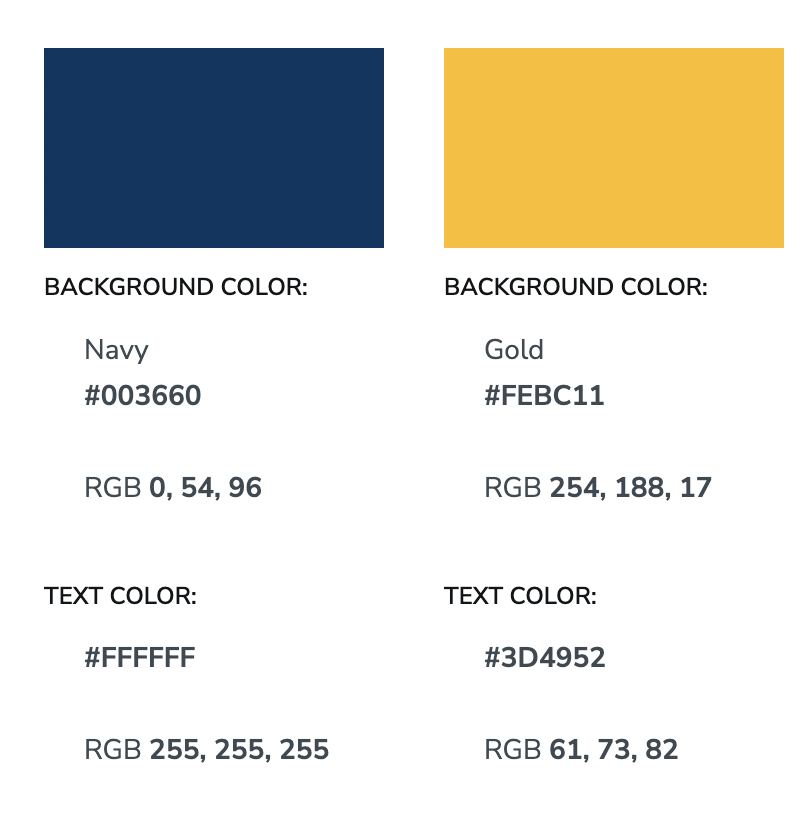{width="50%"}</center>


Color expresses themes, and unified choices make a figure feel professional.


## Hexadecimal representation


There are multiple ways to write the same color:


- `rgb(0, 54, 96)` --- decimal (base-10) representation


- `#003660` --- hexadecimal (base-16, "hex") representation


<center>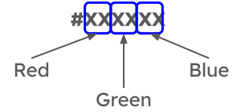{width="50%"}</center>


. . .


Each digit is written in hexadecimal notation:


- `0`--`9` correspond to the familiar values 0 through 9


- `A`--`F` correspond to the decimal values 10 through 15


## Hexadecimal representations


**Base-10 counting (decimal)**


$0_{10},1_{10},2_{10},...,8_{10},9_{10},$ then $10_{10},11_{10},...,19_{10},20_{10},...$


. . .


**Base-16 counting (hexadecimal)**


$0_{16},1_{16},...,9_{16},A_{16},B_{16},...,F_{16},$ then $10_{16},11_{16},...,1A_{16},...,1F_{16}, 20_{16},...$


. . .


And $FF_{16} = 255_{10}$.


Each RGB component runs from $0_{10}$ to $255_{10}$. In hex that range takes exactly **two digits**: the largest two-digit decimal number is $99_{10} = 10^2 - 1$, while the largest two-digit hex number is $FF_{16} = 16^2 - 1 = 255_{10}$.


## Navy and gold


The hex representation of the gold `rgb(254, 188, 17)` is `#FEBC11`.


Red = `FE` (a lot of red), green = `BC` (a good amount), blue = `11` (very little).


```{r, echo=TRUE}

#| output-location: slide

plot_df <- data.frame(x = c("A","B"), y = c(3,7))

ggplot(plot_df) +

  geom_col(aes(x, y, fill = x)) +

  scale_fill_manual(values = c("#003660", "#FEBC11")) +

  theme_minimal(base_size = 16)

```


## Better at renovating our homes


Instead of saying


> *"I want kind of a greenish-blue wall..."*


. . .


we say


> *"The wall color should be `#1B9E77`."*


## RStudio color preview


RStudio provides a preview of the color when they are typed in hexadecimal format.


<center>{width="70%"}</center>


## The default red


```{r, echo=TRUE}

#| output-location: slide

make_plot <- function(hex_color) {

  data.frame(x = 1:3, y = 1:3) |>

    ggplot(aes(x = x, y = y)) +

    geom_point(col = hex_color, size = 5) +

    annotate("text", label = hex_color, x = 1.25, y = 2.75,

             size = 6, color = hex_color) +

    theme_minimal()

}


(make_plot("#FF0000") + make_plot("#0000FF")) /

  (make_plot("#00FF00") + make_plot("#000000"))

```


`#FF0000` is the default red in many programming languages.


Try to avoid it in final plots: it is extreme and synthetic, and it stands out too much. Reserve it for signalling an alarm or a warning.


## Color selection with RGB


:::: {.columns}


::: {.column width="50%"}

```{r, echo=TRUE}

#| fig-height: 3.5

set.seed(100)

x <- rnorm(1000)

data.frame(x) |> ggplot(aes(x = x)) +

  geom_histogram(bins = 30,

                 col = "#FF0000",

                 fill = "#00FF00") +

  theme_minimal()

```

:::


::: {.column width="50%"}

```{r, echo=TRUE}

#| fig-height: 3.5

set.seed(100)

x <- rnorm(1000)

data.frame(x) |> ggplot(aes(x = x)) +

  geom_histogram(bins = 30,

                 col = "#EEEAEA",

                 fill = "#DBBAE6") +

  theme_minimal()

```

:::


::::


Same data, same geometry --- the only difference is two RGB triplets.


## I can do this all day


There are many beautiful color palettes on the internet, and almost all of them are communicated with the RGB system we just learned.


[Best Color Palettes for Scientific Figures and Data Visualizations](https://www.simplifiedsciencepublishing.com/resources/best-color-palettes-for-scientific-figures-and-data-visualizations)


<center>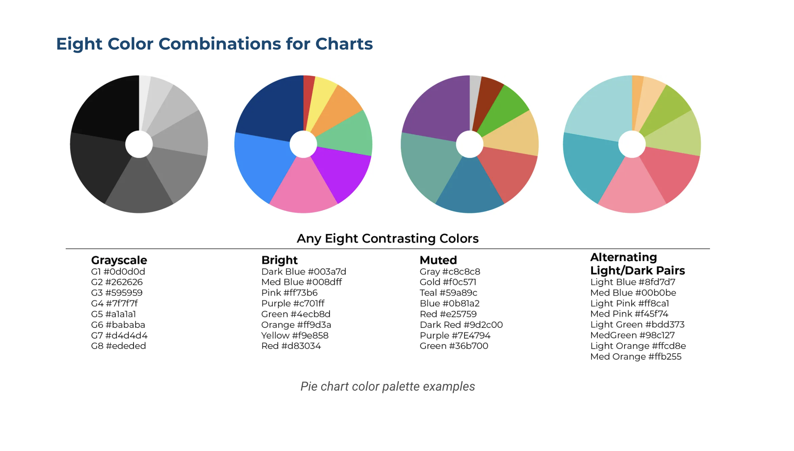{width="60%"}</center>


. . .


[7 Color Palettes Inspired By Famous Paintings](https://www.1000museums.com/7-color-palettes-inspired-by-famous-paintings/)


<center>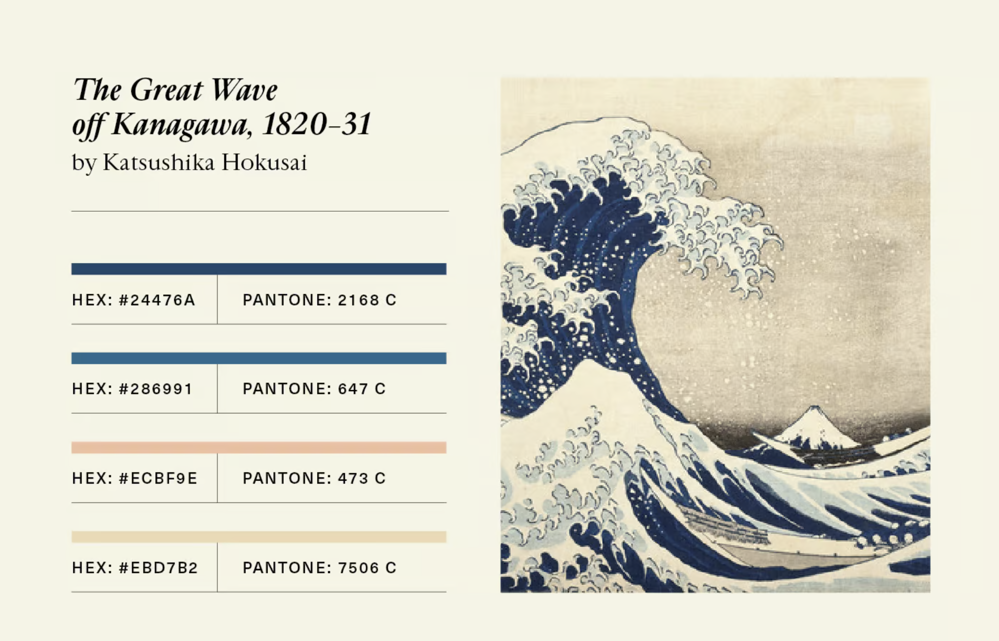{width="60%"}</center>

## Color

There are three main use cases for *color*:

1. Color to distinguish groups of data

2. Color to represent data values

3. Color to highlight

## Color for distinguishing groups

<center>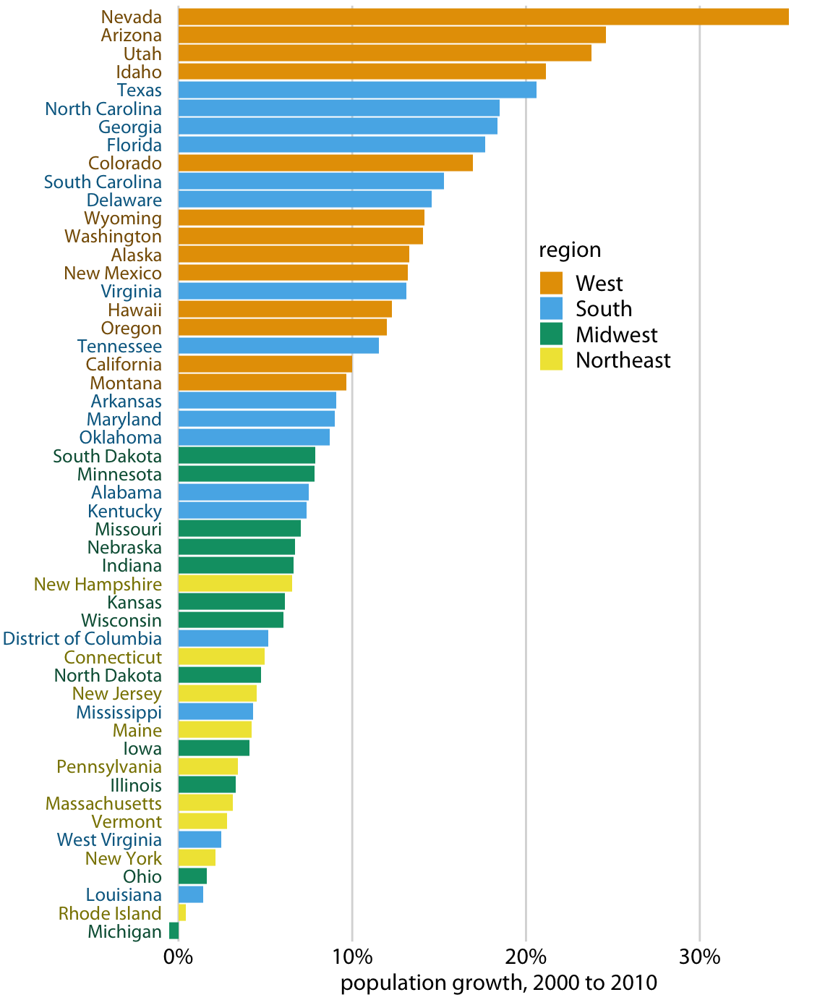{width="50%"}</center>

This uses a _qualitative palette_ to distinguish.

## Color for representing data

<center>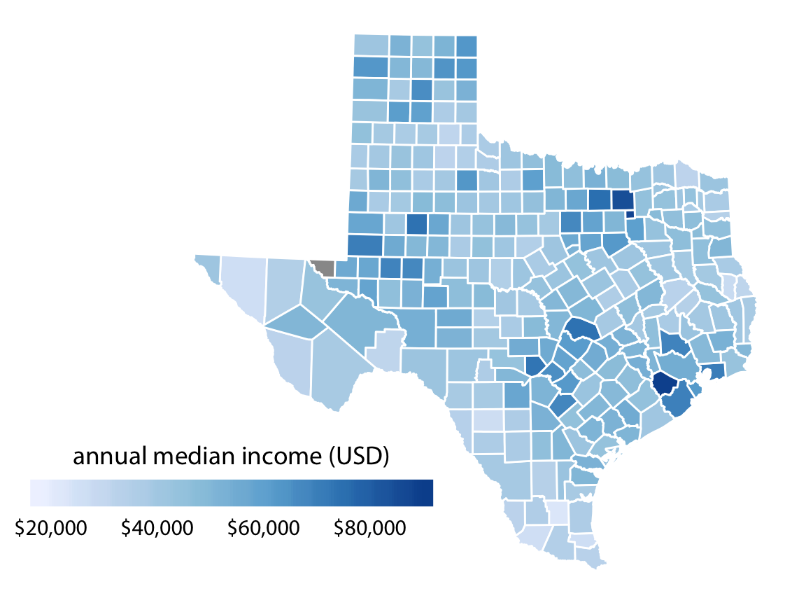{width="50%"}</center>

This uses a _sequentially palette_ to distinguish high income (dark) from low incom (light)

## Color for representing data
<center>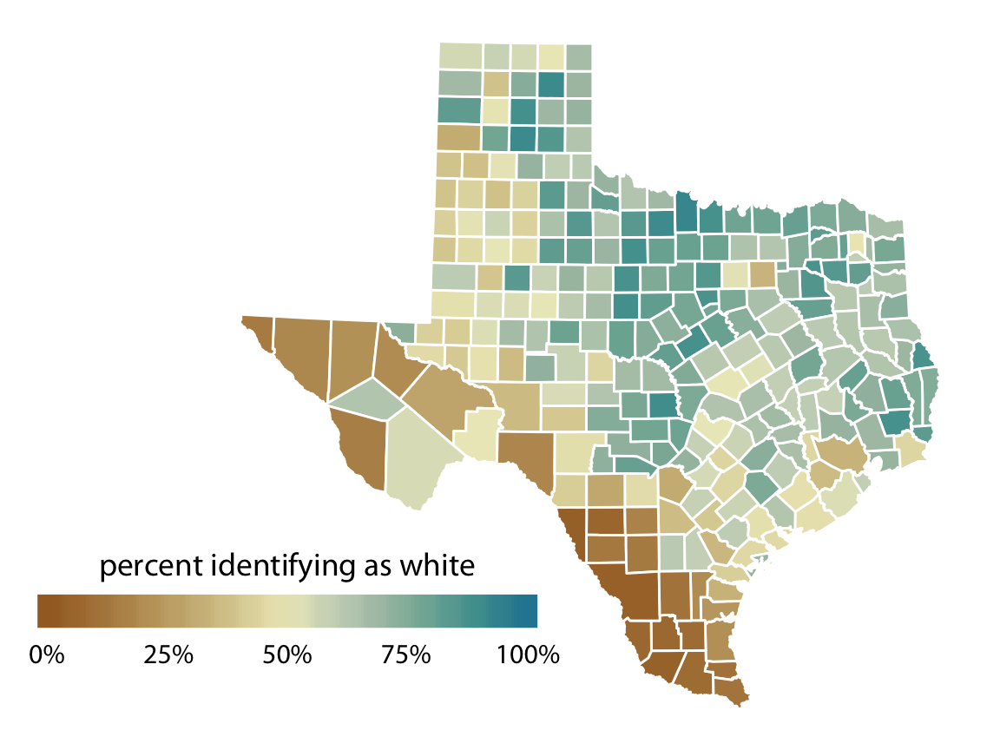{width="50%"}</center>

Notice how the colors *diverge* from toward two distinct colors away from the reference (50%).

## Color for highlighting

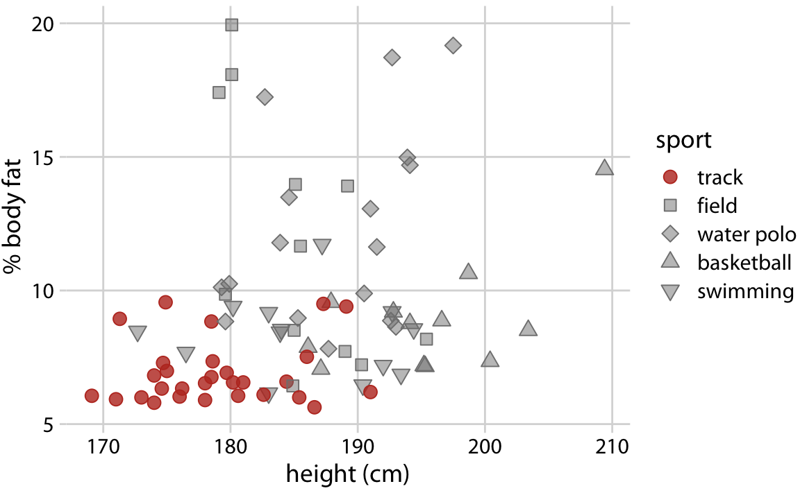

## Pitfalls of Color Use

<center>{width="40%"}</center>

## Pitfalls of Color Use

<center>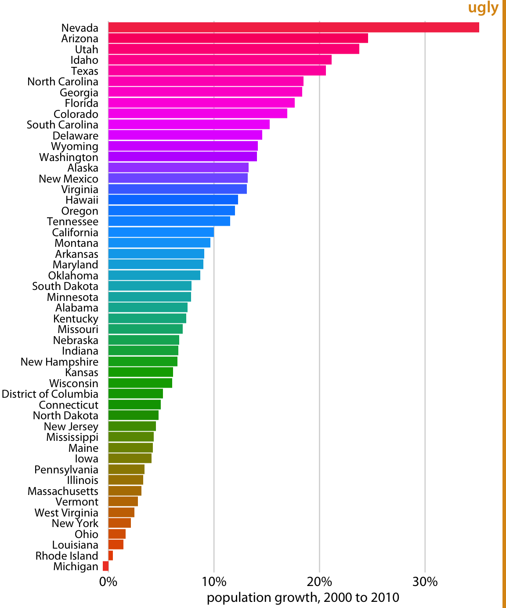{width="40%"}</center>

## Pitfalls of Color Use

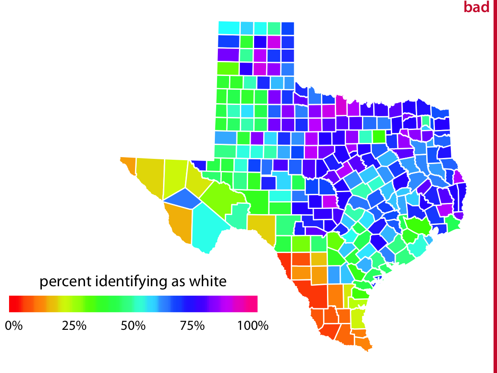{width="40%"}

## Color palettes

Choose the color palette that is most appropriate for your data:

- *Qualitative:* Designed for coding categorical information, i.e., where no particular ordering of categories is available

- *Sequential:* Designed for coding ordered/numeric information, i.e., where colors go from high to low (or vice versa)

- *Diverging:* Designed for coding ordered/numeric information around a central neutral value, i.e., where colors diverge from neutral to two extremes. 

See: [https://cran.r-project.org/web/packages/colorspace/vignettes/colorspace.html](https://cran.r-project.org/web/packages/colorspace/vignettes/colorspace.html)

## RGB manipulation


We can build a sequential palette ourselves by systematically changing the numerical value of a base color. Colors are just numbers.


```{r, echo=TRUE}

#| output-location: slide

base <- "#1B9E77"


light_seq <- lighten(base, amount = seq(0.6, 0.1, length.out = 3))

dark_seq  <- darken(base,  amount = seq(0.1, 0.6, length.out = 3))


seq_pal <- c(light_seq, base, dark_seq)

seq_pal


ggplot() +

  geom_point(aes(x = seq_along(seq_pal), y = seq_along(seq_pal)),

             color = seq_pal, size = 10) +

  theme_minimal(base_size = 16)

```


The Okabe--Ito palette is a well-tested qualitative alternative to the defaults:


```{r, echo=TRUE}

Okabe_Ito <- c("#000000", "#E69F00", "#56B4E9", "#009E73",

               "#F0E442", "#0072B2", "#D55E00", "#CC79A7")

```


It was designed to stay distinguishable for viewers with color vision deficiency.

## Sequential colors

```{r, echo=TRUE}
africa_data |> select(parliament_pct_women) |>
ggplot() +
    geom_sf(aes(fill = parliament_pct_women)) +
    colorspace::scale_fill_continuous_sequential() + 
  theme_void()
```

## Diverging colors

```{r, echo=TRUE}
africa_data <- africa_data |> 
  mutate(across(starts_with("pop_"), \(x) x/total_pop, .names = "{.col}_pct")) |> 
  mutate(pct_under_15 = 1 - pop_15to64_pct - pop_over65_pct)
africa_data |> 
  ggplot() +
    geom_sf(aes(fill = pct_under_15)) +
    colorspace::scale_fill_continuous_diverging(mid=median(africa_data$pct_under_15, na.rm=TRUE), palette="Blue-Red 3") + 
  theme_void()
```

# Composing and comparing plots

## Patchwork

```{r, echo=TRUE}
library(patchwork)
pop_boxplot + pop_histogram
```

## Patchwork

```{r, echo=TRUE}
pop_boxplot / pop_histogram
```

## Faceting

```{r, echo=FALSE}
gdp1 <- read_csv('data/annual_growth.csv')
gdp2 <- gdp1 |> pivot_longer(cols=-c(1,2), names_to="year", values_to="GDP") |> 
  arrange(year, `Country Name`)
```


```{r, echo=TRUE}
#| output-location: slide
#| code-line-numbers: "5"
  gdp2 |> 
  mutate(year = ymd(paste0(year, "-01-01"))) |>
  filter(`Country Name` %in% c("Italy", "France", "Germany", "Spain")) |> 
  ggplot() + geom_line(aes(x=year, y=GDP)) +
  facet_wrap(~`Country Name`) 
```

## GDP 

```{r}
  gdp2 |> 
  mutate(year = ymd(paste0(year, "-01-01"))) |>
  filter(`Country Name` %in% c("Italy", "France", "Germany", "Spain")) |> 
  ggplot() + geom_line(aes(x=year, y=GDP)) +
  facet_wrap(~`Country Name`) + 
  geom_hline(yintercept = 0, linetype="dashed") +
  annotate("rect", xmin=ymd("2008-01-01"), xmax=ymd("2010-01-01"), ymin=-Inf, ymax=Inf, fill="orange", alpha=0.25) +
  annotate("rect", xmin=ymd("1973-01-01"), xmax=ymd("1976-01-01"), ymin=-Inf, ymax=Inf, fill="red", alpha=0.25) + theme_bw()
```

## GDP 

```{r}
  gdp2 |> 
  mutate(year = ymd(paste0(year, "-01-01"))) |>
  filter(`Country Name` %in% c("Italy", "France", "Germany", "Spain")) |> 
  ggplot() + geom_line(aes(x=year, y=GDP)) +
  facet_wrap(~`Country Name`) + 
  geom_hline(yintercept = 0, linetype="dashed") +
  annotate("rect", xmin=ymd("2008-01-01"), xmax=ymd("2010-01-01"), ymin=-Inf, ymax=Inf, fill="orange", alpha=0.25) +
  annotate("rect", xmin=ymd("1973-01-01"), xmax=ymd("1976-01-01"), ymin=-Inf, ymax=Inf, fill="red", alpha=0.25) +
  annotate("text", x=ymd("1977-01-1"), y=11, label="1973-1975 recession", hjust="left", size=3) +
  annotate("text", x=ymd("2008-1-1"), y=7, label="Great Recession", hjust="right", size=3) +
  theme_bw()
```

## Faceting

```{r, echo=TRUE}
ggplot(mpg, aes(displ, hwy)) +
  geom_point() +
  facet_wrap(vars(cyl, drv))
```

## Principle of Proportional Ink

> **The principle of proportional ink:** The sizes of shaded areas in a
> visualization need to be proportional to the data values they 
> represent.

## Redundant Coding


The plot below shows sepal width versus sepal length for three iris species.


<center>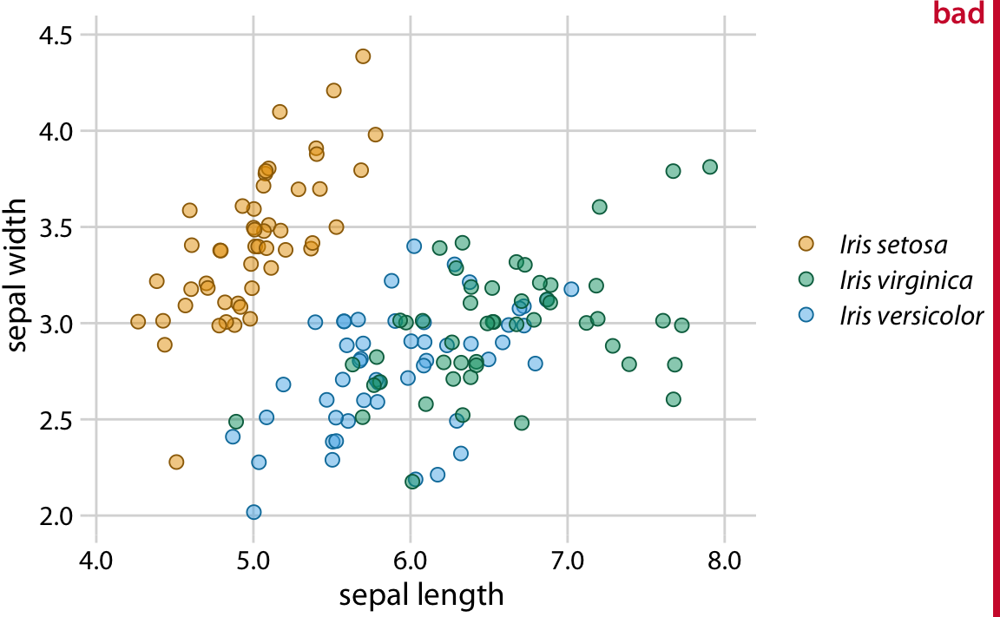{width="55%"}</center>


Why is this plot labeled *bad* (but not *ugly*)?


. . .


The points for *Iris virginica* and *Iris versicolor* intermingle.


## Redundant Coding


Two fixes:


- swap the colors used for *Iris setosa* and *Iris versicolor*;


- use three different symbol **shapes**, so the points differ along two dimensions.


<center>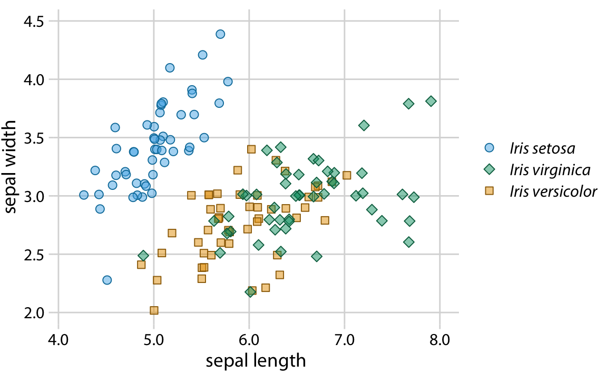{width="55%"}</center>


## Redundant Coding


> **Redundant coding:** a design principle that uses multiple aesthetic dimensions to encode the same data.


- Small colored objects can be hard to distinguish


- Colors may look similar to viewers with color vision deficiency


. . .


Usually a combination of color + shape, or color + point size.


## Order your legend to match your data


Why is this one bad?


<center>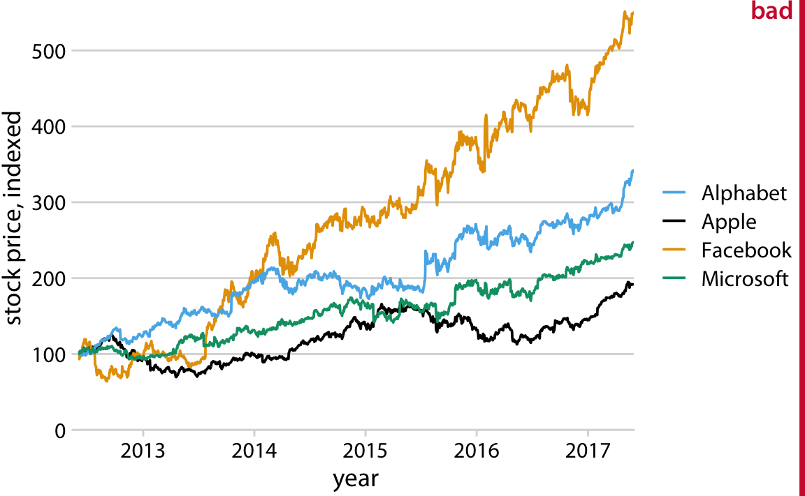{width="55%"}</center>


. . .


<center>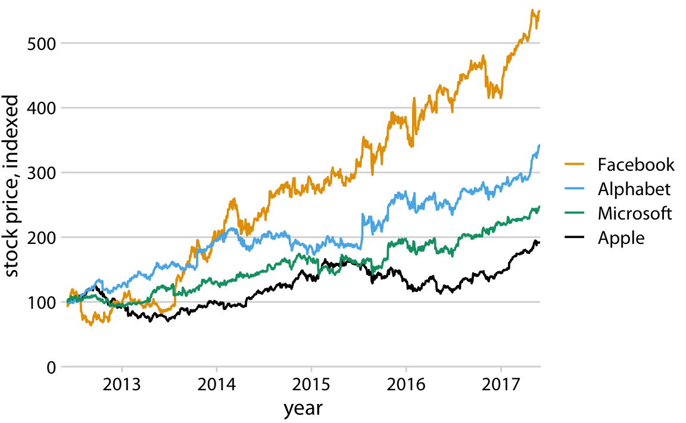{width="55%"}</center>


Match the order of the legend to the order of the curves, not the alphabet.

# Visualization for exploration

<br>

> The greatest value of a picture is when it forces us to notice
> what we never expected to see. 
> 
> — John Tukey

<br>

## Diamonds data

```{r}
glimpse(diamonds)
```

## Diamonds data

Consider the relationship between the length and width of diamonds:

```{r}
#| code-fold: true
#| echo: true

data("diamonds")
ggplot(diamonds, aes(x = x, y = y)) + 
  geom_point()+
  theme_bw()
```

<center>What do you notice? What can be done?</center>

## Naming the outliers

Labelling the extreme points tells us *which* values are the problem:

```{r, echo=TRUE}
#| output-location: slide
ggplot(diamonds, aes(x = x, y = y)) +
  geom_point() +
  geom_text(data = subset(diamonds, x < 3), aes(label = x), nudge_y = 2) +
  geom_text(data = subset(diamonds, y > 30), aes(label = y), nudge_y = 2) +
  theme_bw()
```

A diamond cannot have a length of 0 mm, or be 58.9 mm wide and 5 mm long. These are *data entry mistakes*, not discoveries.

## Outliers and artifacts


```{r}
#| code-fold: true
#| echo: true

diamonds %>% 
 filter(y <= 30, x >= 3) %>% 
ggplot(aes(x = x, y = y)) + 
  geom_point(size=0.1) + theme_bw() 
```

Zooming in and excluding the outliers reveals the underlying relationship much more clearly.

## Handling outliers

- Best to **pre-specify your criteria** for excluding outliers before the analysis

- Show results **with and without** outliers removed. Clearly state:
    + how many observations were excluded (here, 10 of 53,940)
    + the method used for detection
    + how the results differ between the two analyses


## Outliers and artifacts

What about the relationship between length and price?

```{r, echo=TRUE}
diamonds %>% 
 filter(y <= 30, x >= 3) %>% 
ggplot(aes(x = x, y = price)) + 
  geom_point() + theme_bw()

```

We have so many points that *overplotting* becomes an issue.

## Overplotting

```{r, echo=TRUE}
#| output-location: slide
diamonds %>% 
 filter(y <= 30, x >= 3) %>% 
ggplot(aes(x = x, y = price)) + 
  geom_hex(bins=100) + theme_bw() +
  colorspace::scale_fill_binned_sequential(palette = "BurgYl", n.breaks=10)

```

## Overplotting

As an alternative, let's reduce the point size

```{r, echo=TRUE}
#| output-location: slide
diamonds %>% 
 filter(y <= 30, x >= 3) %>% 
ggplot(aes(x = x, y = price, col=cut)) + 
  geom_point(size=0.1) + theme_bw()
```

## Overplotting

Let's reduce the point size even more and add opacity:

```{r, echo=TRUE}
#| output-location: slide
diamonds %>% 
 filter(y <= 30, x >= 3) %>% 
ggplot(aes(x = x, y = price)) + 
  geom_point(size=0.01, alpha=0.2) + theme_bw()
```

## Outliers and artifacts

Let's look at just the diamond length:

```{r, echo=TRUE}
#| output-location: slide
diamonds |> ggplot(aes(x=x)) + geom_histogram()
```

## Outliers and artifacts

A smaller binwidth reveals more structure.

```{r, echo=TRUE}
#| output-location: slide
diamonds |> ggplot(aes(x=x)) + geom_histogram(binwidth=0.1)
```

## Outliers and artifacts

What about price?


```{r, echo=TRUE}
diamonds |> ggplot(aes(x=price)) + 
  geom_histogram(binwidth=100)
```

## Anomalies

Zooming in, there are *no diamonds at all* priced at $1500?

```{r, echo=TRUE}
#| output-location: slide
diamonds |> ggplot(aes(x=price)) + 
  geom_histogram(binwidth=25) + xlim(c(0, 2500))
```

## Anomalies

Buried in a reddit thread:

<center>{width="70%"}</center>

. . .

<center>{width="70%"}</center>

. . .

Many plausible theories but the answer was a missed page while scraping. **Occam's razor:** assume the simplest explanation (e.g a mistake in the data) before you investigate more complex explanations.

## Outliers and artifacts

```{r, echo=TRUE}
diamonds |> ggplot() + 
  geom_point(aes(x=carat, y=price), size=0.1) + 
  theme_bw()


```

## Outliers and artifacts

```{r, echo=TRUE}
diamonds |> ggplot() + geom_point(aes(x=x, y=carat))
```

## Concepts covered in the diamonds data {.smaller}

- **Outliers.** `x = 0` is physically impossible. 

- **Overplotting.** With 50,000 observations a scatterplot turns into a solid blob. Hex bins, smaller points, and opacity each reveal different structure.

- **Resolution.** The default histogram of length hid important structure. Making the binwidth smaller exposed clusters.

- **Artifacts and anomalies.** The missing \$1,500 diamonds are a property of how the data were collected (or weren't collected!) not a property of diamonds themselves.

- **Clustering and hidden variables.** Carat vs price falls into vertical bands. Buyers round up.

- **Occam's razor.** The simplest explanation is usually the best. 


## Billboard Data

Let's return to the billboard dataset

```{r, echo=TRUE}
#| output-location: fragment
billboard_long <- billboard |> 
  pivot_longer(cols = starts_with("wk"), 
               names_to = "week", 
               names_prefix = "wk", 
               names_transform = list(week = as.integer), 
               values_to = "rank")
billboard_long
```

## Exploring song rank

Let's plot the change in song rank for the songs by 3 artists by week:

```{r, echo=TRUE}
#| output-location: slide
billboard_long |> 
  filter(artist %in% c("Jay-Z", "Houston, Whitney", "Aguilera, Christina")) |> 
  drop_na() |>
  ggplot() + geom_line(aes(x=week, y=rank, col=artist, group=track)) +
  theme_bw(base_size=16)
```
<br>

## Exploring song rank

Create a new column which is the actual date the song achieved that rank:

```{r, echo=TRUE}
#| output-location: slide
#| code-line-numbers: "4-5"
billboard_long |> 
  filter(artist %in% c("Jay-Z", "Aguilera, Christina", "Houston, Whitney")) |> 
  drop_na() |>
  mutate(date = date.entered + weeks(week)) |>
  ggplot() + geom_line(aes(x=date, y=rank, col=artist, group=track)) +
  theme_bw(base_size=16)
```

## Exploring Missingness

There is a lot of missingness.  What patterns can we identify?

```{r, echo=TRUE}
#| output-location: slide
billboard_long |> 
  group_by(week) |> 
  summarize(frac_missing = mean(is.na(rank))) |> 
  ggplot() + geom_line(aes(x=week, y=frac_missing)) + 
  theme_bw(base_size=16) +
  xlab("Weeks since entering top 100") + ylab("Fraction missing")
```

<center>What does "fraction missing correspond to"?</center>

## Exploring Missingness


```{r, echo=TRUE}
#| output-location: slide
billboard_long |> 
  group_by(week) |> 
  summarize(frac_missing = mean(is.na(rank))) |> 
  ggplot() + geom_line(aes(x=week, y=frac_missing)) + 
  theme_bw(base_size=16) +
  xlab("Weeks on top 100") + ylab("Percent of Songs")
```

<center>What do you notice?</center>

## The Recurrent Rule

> If a song has been on the Hot 100 chart for 20 weeks and is not currently inside the top 50 (or lacks strong upward momentum), Billboard automatically removes it from the chart, to prevent long-running hits from stagnating the rankings and blocking new entries.


## Concepts covered in the billboard data {.smaller}

- **Tidying helps plotting.** `wk1...wk76` are values of a variable, not 76 variables.

- **Color vs. grouping.** Jay-Z has five songs and without the grouping they get drawn as one line. Set `col = artist` and `group = track` to see all of them.

- **Choices for the x-axis.** Weeks-since-entering vs. calendar date answer different questions about the same data.

- **Missingness is data.** The fraction of missing values at each week has meaning in the context of the Billboard chart.


## Comparing data across groups

 What's the best way to compare data across multiple groups?

- Same plot? Different plot?

- Absolute vs relative?

- `patchwork` and `facet_wrap` as tools  

## Planned Parenthood Example

<center>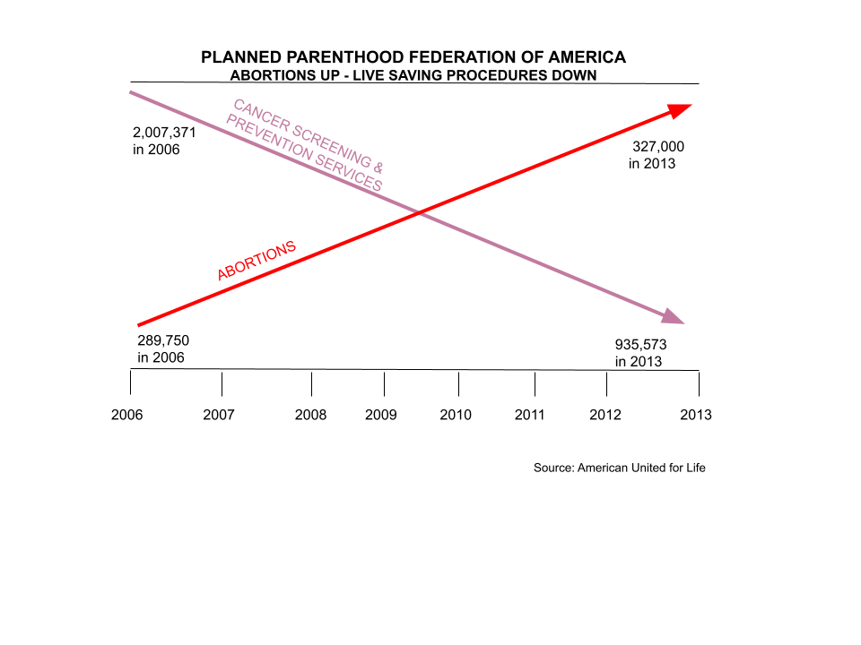</center>

```{r, echo=FALSE}
## The following data are collected from Planned Parenthood Federation of American Annual Report from 2006-2013

year <- c(2006, 2007, 2008, 2009, 2010, 2011, 2012,2013)
cancerscreen <- c(2007371, 1900850, 1860413, 1830811, 1596741, 1307570, 1121580, 935573)
abortions <- c(289750, 305310, 324008, 331796, 329445, 333946, 327166, 327653)
pp_data = tibble(year=year, cancerscreen=cancerscreen, abortions=abortions)
```

## Planned parenthood services

```{r, echo=TRUE}
#| output-location: slide
cancer_plot <- pp_data |> ggplot() + geom_line(aes(x=year, y=cancerscreen)) + theme_bw() 
abortion_plot <- pp_data |> ggplot() + geom_line(aes(x=year, y=abortions)) + theme_bw()

## Plot them side by side
cancer_plot + abortion_plot 
```


<!-- ::: notes -->
<!-- Information about the chart: The following graph was presented by Jason Chaffetz, the Chairman of the House Committee on Oversight and Government Reform. This chart was presented to Cecile Richards the head of Planned Parenthood during her testimony at public hearing. The chart suggested that Planned Parenthood performs more abortions than cancer screenings and prevention services. [Source: Committee of Oversight and Accountability Democrats](https://oversightdemocrats.house.gov/news/press-releases/politifact-awards-chaffetz-a-rating-of-pants-on-fire-for-using-misleading-chart) -->

## On the same plot

```{r, echo=TRUE}
#| output-location: slide
pp_data |> ggplot() +
  geom_line(aes(x=year, y=cancerscreen), col="blue") + 
  geom_line(aes(x=year, y=abortions), col="red") + 
  ylab("") +
  theme_bw()
```

## Absolute vs relative levels

Absolute levels: 

```{r, echo=TRUE}
#| output-location: slide
pop |> 
  filter(`Country Name` %in% c("Oman", "United States")) |>
  ggplot() + geom_line(aes(x=Year, y=Population, col=`Country Name`)) + 
  theme_bw(base_size=16)
```

## Absolute vs relative levels

Relative levels:

```{r, echo=TRUE}
#| output-location: slide
pop |> 
  group_by(`Country Name`) |>
  mutate(`Relative Population Change` = Population / first(Population[Year=="1960-01-01"])) |>
  filter(`Country Name` %in% c("Oman", "United States")) |>
  ggplot() + geom_line(aes(x=Year, y=`Relative Population Change`, col=`Country Name`)) +
  theme_bw(base_size=16) +
  scale_y_continuous(breaks=1:10)
```

## Concepts covered {.smaller}

- **Absolute and relative answer different questions.** Since 1960 Oman's population grew 9-fold and the US grew 12-fold. But the US added 148 million people and Oman added 4.4 million.

- **Shared axes vs separate axes.** The first plot has a shared y-axis, which makes it easy to compare absolute levels. The second plot has separate y-axes, which makes it easy to compare relative growth.

- **Normalizing requires a baseline.** Results depend on choosing 1960.  A different baseline year might tell a different story.


## Workflow tips and advice {.smaller}

Developing a graphic is iterative trial and error. A reasonable loop:

- **Start with a question.** e.g. "Does the gender gap shrink with income?", not "let's make a bar chart." 

- **Make the crudest version first.** Default geom, default theme, no labels. You are only asking whether there is anything there at all.

- **Change one thing at a time.** 

- **Ask new questions based on what you see in the plots.** Most of what we saw today came from reacting to something we saw in a plot, not from a pre-specified plan.

## Some additional tips

| Symptom | Things to try |
|-------------------------------|--------------------------------------------|
| Solid blob of points | smaller points, `alpha`, `geom_hex()` |
| A few outlier points ruin the scale | set a rule for removing and report what you dropped |
| Distribution looks featureless | change `binwidth`, zoom in  |
| Too many lines or colors | facet, or gray out everything but the ones you mean |
| Groups on wildly different scales | plot relative change instead of absolute |
| Two panels you can't compare | one shared axis instead of `patchwork` |
| Reader can't find the point | say it in the title and provide a label directly instead of a legend |

<!-- ## -->

<!-- The graphic indicates in particular that: -->

<!-- - global population growth (total height of bar) is increasing linearly; -->

<!-- - the share of the global population in Asia is increasing over time. -->

<!-- # Principles of effective visualization -->

<!-- - Desiderata: novel; informative; efficient; pleasing. -->

<!-- - Workflow for developing effective plots -->

<!-- - Tips and advice -->

<!-- ## What makes visualizations effective? -->

<!-- Iliinsky introduces some *desiderata* for data visualizations. -->

<!-- The article focuses on going beyond conventional 'formats' (scatterplot, bar chart, etc.), but I think we can equally well apply the criteria to standard statistical graphics. -->

<!-- - **Novel.** Novel visuals don't need to elicit superlative reactions, but they should (if only subtly) surprise and spark interest to some extent. -->
<!--     - Were *you* excited or interested when you made the plot? -->

<!-- - **Informative**. Informative visuals make information apparent. In a way they are *unambiguous*. -->
<!--     - Did you learn something when you made the plot? -->
<!--     - Did you have to think very hard to understand what the plot has to say? -->

<!-- - **Efficient**. Efficient visuals have an accessible message. They use space economically but without becoming overly complicated. -->
<!--     - Include exactly what you want to show -- nothing more, nothing less. -->
<!--     - Did you add anything that doesn't really need to be there? -->

<!-- - **Pleasant**. Visuals should be nice to look at! -->
<!--     - Do you smile a little when you open up that plot? -->

