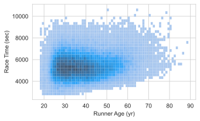
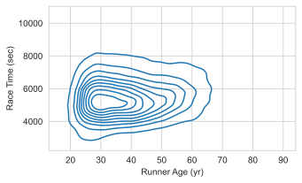

```{r}
library(tidyverse)

air <- read_csv('data/air.csv')
air <- air |> rename(all_of(c(PM25_98pct = "PM2.5...7",
                              PM25_mean = "PM2.5...8",
                              NO2_98pct = "NO2...3",
                              NO2_mean = "NO2...4")))

pmdata <- air |> select(PM25_mean, City, State, Year) |>
  drop_na()
```

## This week: EDA and smoothing

* **What is exploratory data analysis (EDA)?**
    + The role of data: information or evidence?
    + Exploratory vs. confirmatory analysis
    + Essential exploratory questions: variation and co-variation

* **Smoothing**
    + Kernel density estimation (KDE)
    + LOESS

## EDA

The term and spirit of *exploratory data analysis* (EDA) is attributed to John Tukey, whose philosophically-leaning work in statistics in the 1960's and 1970's stressed the need for more data-driven methods.

> *For a long time I have thought I was a statistician, interested in inferences from the particular to the general ... All in all, I have come to feel that my central interest is in **data analysis** [which] is a larger and more varied field than inference.* (Tukey, 1962)

EDA is an initial stage of non-inferential and largely model-free analysis aiming at understanding the structure, patterns, and particularities present in a dataset.

## Data as evidence

Experimental data usually serve the role of **evidence** for or against prespecified hypotheses.


$$
\text{hypothesis} \longrightarrow \text{data} \longrightarrow \text{inference}
$$

For example, in vaccine efficacy trials, RCT data are collected precisely to affirm or refute the hypothesis of no effect:

Vaccine group | Placebo group
---|---
11 cases | 185 cases

$\hat{P}(\text{case is in the vaccine group} | \text{there is a case}) = 0.056 \quad\Longrightarrow\quad \text{evidence of effect}$

## Data as information

By contrast, observational data more often serve the role of **information** about some phenomenon.

For example, a secondary trial target might is to assess saftey by gathering observational data on side effects; for this there is no hypothesis.


{height=400}

## EDA then CDA

The picture that most practitioners have of modern data science is that EDA precedes confirmatory data analysis (CDA).

1. EDA is used to generate hypotheses or formulate a model based on patterns in the data
2. CDA, consisting of model specification and estimation, is used for inference and/or prediction

## Essential exploratory questions

> *When you ask a question, the question focuses your attention on a specific part of your dataset and helps you decide which graphs, models, or transformations to make.*

There are two basic kinds of questions that are always useful: 

1. What type of variation occurs within variables?
2. What type of *co*variation occurs between variables?

## Variation in one variable

**Variation** in data is the _**tendency of values to change from measurement to measurement**_.

For example, the following observations from your mini project data are around 8 $\mu g/m^3$, but each one is different.

```{r}
#| tags: []
print(pmdata, n=10)
```

*What does it mean to ask what 'type' of variation there is in this data?*

## Questions about variation

There aren't exact types of variation, but here are some useful questions:

* (**Common**) Which values are most common?

* (**Rare**) Which values are rare?

* (**Spread**) How spread out are the values and how are they spread out?

* (**Shape**) Are values spread out evenly or irregularly?

These questions often lead the way to more focused ones.

## Air quality {.smaller}

The following histogram shows the distribution of PM 2.5 concentrations across all 200 cities and 20 years.

```{r}
pmdata |> 
  ggplot() + geom_histogram(aes(x=PM25_mean)) + 
  theme_bw(base_size=16)
```


It shows several statistical properties of the data related to variation:

* The **common** values have the highest bars -- values between roughly 6 and 14.

* Values under 4 and over 18 are **rare**, accounting for under 5% of the data.

* Values are **concentrated** between 4 and 18, but are **spread** from 2 to 52.

* The **shape** is pretty symmetric but a little more spread out to the right ("right skew").

## Question refinement

*New question:* The national standard is 12 micrograms per cubic meter. Over 1,000 measurements exceeded this. Was it just a few cities, or more widespread?

```{r}
#| echo: true
#| output-location: slide

nyears_over12 <- pmdata |> 
  group_by(City, State) |> 
  summarize(count = sum(PM25_mean > 12))

nyears_over12 |> 
  ggplot() + geom_histogram(aes(x=count), bins=15) + 
  xlab("Number of years over 12ppm") + 
  ylab("Number of cities") + 
  theme_bw()

```
## Question refinement

```{r, echo=TRUE}
mean(nyears_over12$count > 0)
```


Many cities exceeded the standard at some point in time: over 70% of the cities in the dataset. So it was more widespread, but these were the worst:

```{r}
nyears_over12 |> arrange(desc(count))
```

## Further questions

How many cities exceed the benchmark each year? Does this change from year to year?

::: {.columns}

::: {.column width=55%}
```{r, echo=TRUE}
pmdata |> 
  ggplot(aes(x = PM25_mean, fill = factor(Year))) +
  geom_histogram(position = "identity", 
                alpha = 0.7,
                bins = 30) +
  scale_x_continuous(name = "Weighted annual average PM 2.5") +
  scale_y_continuous(name = "count") +
  labs(fill = "Year")
```
:::

::: {.column width=40%}
There are a lot of years and it's hard to see anything with all the overlapping bars.

* Remember the rule? Don't stack histograms.
* Use density plots instead.
:::

:::

## Further questions

Visually, it's a lot easier to distinguish overlapping lines than overlapping bars. Smoothing out the histogram produces this:

::: {.columns}

::: {.column width=60%}
```{r}
pmdata |> ggplot(aes(x = PM25_mean, color = factor(Year))) +
  geom_density(
    adjust = 1.5,
    alpha = 0.5,
  ) +
  xlab("Weighted annual average PM 2.5") +
  xlim(c(0, 55)) +
  ylab("Density") + theme_bw(base_size=16)
```
:::

::: {.column width=40%}
This shows that *both* the variation in PM 2.5 *and* the typical values are diminishing over time.

* suggests fewer cities exceed the EPA standard (12 $\mu g/m^3$) over time
* a few outliers in some early year
* not the best presentation graphic, but useful exploratory graphic
:::

:::

## Further questions

```{r}
library(colorspace)
pmdata |> ggplot(aes(x = PM25_mean, color = Year, group=Year)) +
  geom_density(
    adjust = 1.5,
    alpha = 0.5,
  ) +
  xlab("Weighted annual average PM 2.5") +
  xlim(c(0, 25)) +
  ylab("Density") + theme_bw(base_size=16) +
  colorspace::scale_color_continuous_sequential(palette="Viridis")
```

## Further questions

This might get the message across better:

```{r}
library(colorspace)
pmdata |> 
  mutate(Year = ymd(paste0(Year, "-01-01"))) |>
  ggplot(aes(y = PM25_mean, x=Year)) +
  ggdist::stat_dist_interval(.width=c(0.5, 0.75)) +
  ylab("Weighted annual average PM 2.5") +
  xlab("Year") + theme_bw(base_size=16) 
```


## Further questions {.smaller}

::: {.columns}

::: {.column width=50%}
This is also effective.

```{r}
# First create the summarized data
plot_data <- pmdata %>% 
  filter(PM25_mean > 12) %>%
  group_by(Year) %>%
  summarise(`Number of Cities` = n()) %>%
  ungroup()

# Create the plot with both points and lines
plot_data |> ggplot(aes(x = Year, y = `Number of Cities`)) +
  geom_point() +  geom_line(alpha = 0.4) +  
  labs(x = "Year", y = "Number of cities exceeding EPA standard") +
  theme_bw(base_size=16)
```
:::

::: {.column width=50%}
And here are the outlying values with large PM25:

```{r}
pmdata |> filter(PM25_mean > 30)
```
:::

:::

## Density estimates

All of the above has amounted to exploration of the distribution of PM 2.5 values across years and cities. 


*Density estimates* provide smooth approximations of distributions:

```{r}
#| output-location: slide
#| code-line-numbers: "4-5"
library(ggplot2)

# Create the plot with both line and filled density
ggplot(pmdata, aes(x = PM25_mean)) +
  geom_density(alpha = 0.5, fill = "blue", col="black") +
  scale_x_continuous(
    name = "Weighted annual average PM 2.5",
    limits = c(0, 55)  
  ) +
  scale_y_continuous(
    name = "Density",
    trans = "sqrt"
  ) 
```

These are useful tools for answering questions about variation. Relative to the histogram:

* Easier to see the shape, spread, and typical values quickly.
* Easier to compare multiple distributions.

## Histograms and probability densities

From 120A, a probability density/mass function has two properties:

1. Nonnegative: $f(x) \geq 0$ for every $x \in \mathbb{R}$.
2. Sums/integrates to one: $\int_\mathbb{R} f(x) dx = 1$ or $\sum_{x \in \mathbb{R}} f(x) = 1$

Histograms are *almost* proper density functions: they satisfy (1) but not (2). 

## A preliminary: indicator functions

In what follows we're going to express the histogram mathematically as a function of data values.

This will require the use of **indicator functions**, which are simply _**functions that are 1 or 0 depending on a condition**_. They are denoted like this:

$$
\mathbf{1}\{\text{condition}\} = \begin{cases} 1 &\text{ if condition is true} \\ 0 &\text{ if condition is false} \end{cases}
$$

The sum of an indicator gives a count of how many times the condition is met:

$$
\sum_i \mathbf{1}\{x_i > 0\} = \#\text{ of values that are positive}
$$

## Count scale histograms

When the bar height is a count of the number of observations in each bin, the histogram is on the **count scale**. 

More precisely, if the values are $x_1, \dots, x_n$, then the height of the bar for the $j$th bin $B_j = (a_j, b_j]$ is:
$$
\text{height}_j = \sum_{i = 1}^n \mathbf{1}\{x_i \in B_j\}
$$ 

## Count scale histograms


Bad for comparisons: the bar heights incomparable in scale whenever the bin widths and/or sample sizes differ.

```{r}
#| output-location: column
library(ggplot2)
library(patchwork)  # for combining plots

# Create first histogram with 15 bins
hist1 <- ggplot(pmdata, aes(x = PM25_mean)) +
  geom_histogram(
    bins = 15, alpha = 0.4, 
    fill = "orange", color = "black"
  ) + labs(x = "Weighted annual average PM 2.5", y = "count") +
  theme_bw(base_size=16)

# Create second histogram with 30 bins
hist2 <- ggplot(pmdata, aes(x = PM25_mean)) +
  geom_histogram(
    bins = 30, alpha = 0.4,
    fill = "blue",color = "black"
  ) + labs(x = "Weighted annual average PM 2.5", y = "count") +
  theme_bw(base_size=16)

# Combine the plots side by side
hist1 + hist2
```


## Density scale histograms

A fix that ensures comparability of scale for any two histograms is to  <font color='red'>normalize</font> heights by bin width $b$ and sample size $n$.

$$
\text{height}_j = \color{red}{\frac{1}{nb}} \sum_{i = 1}^n \mathbf{1}\{x_i \in B_j\} \quad\text{where}\quad b = b_j - a_j
$$

Now the area under the histogram is $\sum_j b \times \text{height}_j = 1$, so we call this a **density scale** histogram, because it is a valid probability density.

## Smoothing

**Kernel density estimates** are _**local smoothings of the density scale histogram**_.

This can be seen by comparing the type of smooth curve we saw earlier with the density scale histogram.

```{r}
#| output-location: slide
library(ggplot2)

# Calculate bin width and total observations for density calculation
bin_width <- 2
n_obs <- nrow(pmdata)

# Create the combined plot
ggplot(pmdata, aes(x = PM25_mean)) +
  geom_histogram(
    aes(y = after_stat(density)),
    binwidth = bin_width,
    fill = "lightgray",
    color = "white",
    size = 0.1
  ) +
  geom_density(
    adjust = 4,  
    color = "black",
    alpha = 0.5
  ) +
  xlab("Average long-term PM 2.5") + ylab("Density") + 
  xlim(c(0, 55)) + ylim(c(0, 0.15)) +
  scale_y_continuous(trans = "sqrt") +
  theme_minimal() 
```

## How KDE works

Technically, KDE is a convolution filtering. We can try to understand it in more intuitive terms by developing the idea constructively from the density histogram in two steps.

1. Do locally adaptive binning
2. Replace counting by weighted aggregation


## The histogram as a step function

The value (height) of the density scale histogram at an arbitrary point $\color{red}{x}$ is
$$
\text{hist}(\color{red}{x}) = \frac{1}{nb} \sum_{i = 1}^n \sum_{j} \mathbf{1}\{\color{red}{x} \in B_j\} \mathbf{1}\{x_i \in B_j\}
$$


Here's what those indicators do:

$$
\mathbf{1}\{\color{red}{x} \in B_j\} \quad \text{finds the right bin}\;,\quad
\mathbf{1}\{x_i \in B_j\} \quad \text{picks out the data points in the bin}
$$


{height=300}

## A 'local' histogram

One could do a 'moving window' binning by allowing the height at $\color{red}{x}$ to be a normalization of the count *in a neighborhood of $x$ of width $b$* rather than in one of a fixed set of bins:

$$
\text{hist}_\text{local}(\color{red}{x}) = \frac{1}{nb} \sum_{i = 1}^n \mathbf{1}\left\{|x_i - \color{red}{x}| < \frac{b}{2}\right\}
$$

Let's call this a **local histogram**, because the height at any point $\color{red}{x}$ is determined relative to the exact location of $\color{red}{x}$.


## Drawing a local histogram

$$
\text{hist}_\text{local}(\color{red}{x}) = \frac{1}{nb} \sum_{i = 1}^n \mathbf{1}\left\{|x_i - \color{red}{x}| < \frac{b}{2}\right\}
$$

```{r, echo=FALSE}
library(ggplot2)

# Set random seed
set.seed(42223)

# Create the sample data
samp <- data.frame(
  x = runif(n = 5, min = 0, max = 10),
  y = 0  # Adding constant y value
)

# Create the plot
ggplot(samp, aes(x = x, y = y)) +
  geom_point(color = "black", size = 5) +  # size in ggplot is roughly 1/10 of Altair size
  scale_y_continuous(
    name = "density",
    limits = c(0, 0.6)
  ) +
  scale_x_continuous(
    limits = c(0, 10)
  ) +
  theme_minimal() 
```

## PM 2.5 data

Here's what that would look like with $b = 1$ for the air quality data:

```{r}
# output-location: slide

# Create the grid and set bandwidth
grid <- seq(0, 50, length.out = 1000)
bw <- 1

# Calculate density values - vectorized calculation for efficiency in R
calculate_densities <- function(grid_points, data, bandwidth) {
  clean_data <- data$PM25_mean[!is.na(data$PM25_mean)]
  sapply(grid_points, function(g) {
    sum(abs((g - clean_data)/(bandwidth/2)) < 1) / (bandwidth * 4280)
  })
}

# Calculate densities
dens <- calculate_densities(grid, pmdata, bw)

# Create dataframe for plotting
curve <- data.frame(x = grid, y = dens)

# Create the plot with both area and line
ggplot(curve, aes(x = x, y = y)) +
  # Add filled area
  geom_area(alpha = 0.5, fill = "skyblue") +
  # Add line on top
  geom_step(size = 0.5, color = "black") +
  theme_bw(base_size=16)
```

## PM 2.5 data

Zooming in reveals that this is still a step function:

```{r}
# Create the plot with both area and line
ggplot(curve, aes(x = x, y = y)) +
  # Add filled area
  geom_rect(aes(xmin=x, xmax=lead(x), ymin=0, ymax=y), alpha = 0.5, fill = "skyblue") +
  # Add line on top
  geom_step(size = 0.5, color = "black") +
  theme_minimal() + xlim(c(6, 15))
```

## The kernel function

The local histogram is in fact a density estimate with a uniform 'kernel':
$$
\text{hist}_\text{local}(\color{red}{x}) = \frac{1}{n} \sum_{i = 1}^n \underbrace{\frac{1}{b}\mathbf{1}\left\{|x_i - \color{red}{x}| < \frac{b}{2}\right\}}_\text{kernel function}
$$

* uniform because the kernel function is constant about $x$
* when $x_1, \dots, x_n$ are a random sample, this is an estimate of the population denisty 

## Gaussian KDE

Replacing the uniform kernel with a Gaussian kernel yields a smooth density estimate:
$$
\hat{f}(\color{red}{x}) = \frac{1}{n} \sum_{i = 1}^n \frac{1}{b}\varphi\left(\frac{x_i - \color{red}{x}}{b}\right)
$$

* $\varphi$ is the standard Gaussian density $\varphi(z) = \frac{1}{\sqrt{2\pi}}\exp\left\{- \frac{z^2}{2}\right\}$
* $b$ is the smoothing 'bandwidth'

In effect, the KDE curve at any point $\color{red}{x}$ is a weighted aggregation of *all* the data with weights proportional to their distance from $\color{red}{x}$.

## Smoothing bandwidth

The bandwidth parameter $b$ controls how wiggly the KDE curve is.

```{r, echo=FALSE}
#| output-location: slide

# Create base histogram
create_hist_with_density <- function(data, bw, title) {
  ggplot(na.omit(data), aes(x = PM25_mean)) +
    # Add histogram
    geom_histogram(
      aes(y = after_stat(density)),  # scale to density
      bins = 30,
      fill = "lightgray",
      color = "white"
    ) +
    geom_density(
      bw = bw,
      color = "black"
    ) +
    labs(
      x = "Average long-term PM 2.5",
      y = "Density",
      title = title
    ) +
    xlim(c(0, 55)) +
    theme_bw(base_size=16)
}

# Create both plots
plot_high_bw <- create_hist_with_density(pmdata, 3, "b = 3")
plot_low_bw <- create_hist_with_density(pmdata, 0.5, "b = 0.5")

# Combine plots side by side
plot_high_bw | plot_low_bw
```

The choice of smoothing bandwidth can change the visual impression.

* too much smoothing can obscure outliers and multiple modes
* too little smoothing can misleadingly overemphasize sample artefacts

## Other kernels

In general, a KDE can be computed with any appropriately normalized nonnegative kernel function $K_b(\cdot)$.

$$
\hat{f}_{K_b}(\color{red}{x}) = \frac{1}{n} \sum_{i = 1}^n K_b\left(x_i - \color{red}{x}\right)
$$

Other common kernel functions include:

* triangular kernel $K(z) = 1 - |z|$
* parabolic kernel $K(z) \propto 1 - z^2$
* cosine kernel $K(z) \propto \cos\left(\frac{\pi z}{2}\right)$
* circular density $K(z) \propto \exp\left\{k\cos(z)\right\}$
* any symmetric continuous probability density function


## Sustainability data

We'll work with sustainability index data for US cities to explore density estimation further.

```{r}
sust <- read_csv('data/sustainability.csv')
sust 
```

* 933 distinct cities 
* indices for sustainability in enviornmental, social, and eonomic domains

## Environmental sustainability index

Let's use the environmental sustainability index (`Env_Domain`) initially. The distribution of environmental sustainability across cities is shown below.

```{r}
# Create histogram with density estimate
ggplot(sust, aes(x = Env_Domain)) +
  geom_histogram(aes(y = after_stat(density)), binwidth = 0.02) +
  geom_density(color = "black") +
  theme_minimal() +
  labs(x = "Environmental sustainability index", y = "Density")
```

## KDE bandwidth selection

A common choice for Gaussian KDE bandwidth is Scott's rule: 

$$
b = 1.06 \times \hat \sigma \times n^{-1/5}
$$

```{r}
n <- length(sust$Env_Domain)
h <- 1.06 * sd(sust$Env_Domain) * n^(-1/5)

# Assuming 'sust' is your dataframe and 'Env_Domain' is your column
ggplot(sust, aes(x = Env_Domain)) +
  geom_histogram(aes(y = after_stat(density)), 
                 alpha = 0.5,
                 bins = 30) +
  geom_density(bw = h,
               color = "black") +
  labs(x = "Environmental sustainability index",
       y = "Density") +
  theme_bw(base_size=16)
```

## Other Kernels

`geom_density` plots a smooth density based on itself calling the `density` function in R.

```{r}
set.seed(5309)

sigma_hat <- sd(sust$Env_Domain)

sust_sub <- sust |> sample_frac(0.05)
n <- nrow(sust_sub)
bw_scott <- 1.06 * sigma_hat * n^(-1/5)
# Assuming 'sust' is your dataframe and 'Env_Domain' is your column
plot_density <- function(kernel = "gaussian", bw=bw_scott) {
  
  sust_sub |>
  ggplot(aes(x = Env_Domain)) +
  geom_histogram(aes(y = after_stat(density)), 
                 alpha = 0.5,
                 bins = 30) +
  geom_density(color = "black",
               bw = bw,
               kernel = kernel) +
  labs(x = "",
       y = "") +
  theme_bw(base_size=16) + ggtitle(kernel)
}

```

## 

```{r}
(plot_density("gaussian") + plot_density("rectangular", bw=0.01)) /
(plot_density("epanechnikov") + plot_density("triangular"))
```
## 

```{r}
sust_sub |>
  ggplot(aes(x = Env_Domain)) +
  geom_density(color = "black",
               bw = bw_scott,
               kernel = "gaussian") +
  geom_density(color = "red",
               bw = bw_scott,
               kernel = "epanechnikov") +
  geom_density(color = "blue",
               bw = bw_scott,
               kernel = "triangular") +
  labs(x = "",
       y = "") +
  theme_bw(base_size=16)

```

## 2D Histograms


## Overplotting revisited

Now let's estimate the joint distribution of environmental and economic sustainability indices. Here are the values:

```{r}
# Plot multivariate data
ggplot(sust, aes(x = Env_Domain, y = Econ_Domain)) +
  geom_point() +
  theme_minimal() +
  labs(x = "Environmental sustainability", y = "Economic sustainability")
```

## 2D Histograms
```{r}
# Create 2D histogram
ggplot(sust, aes(x = Env_Domain, y = Econ_Domain)) +
  geom_bin2d(bins = 40) +
  scale_fill_viridis_c() +
  theme_minimal() +
  labs(x = "Environmental sustainability", y = "Economic sustainability")
```

## 2D Histograms

```{r}
# Create 2D histogram
ggplot(sust, aes(x = Env_Domain, y = Econ_Domain)) +
  geom_hex(bins = 40) +
  scale_fill_viridis_c() +
  theme_minimal() +
  labs(x = "Environmental sustainability", y = "Economic sustainability")
```

## KDE in higher 

KDE can be generalized to estimating joint densities in $p$ dimensions:

$$
\hat{f}_K (\mathbf{x}) = \frac{1}{n} \sum_i |\mathbf{B}|^{-1/2} K \left(\mathbf{B^{-1/2}}(\mathbf{x} - \mathbf{x}_i)\right)
$$

* $\mathbf{x}\in\mathbb{R}^p$ is a $p$-dimensional vector
* $K:\mathbb{R}^p \rightarrow \mathbb{R}$ is a nonnegative kernel function
* $B$ is a $p\times p$ matrix of bandwidth parameters

The usual approach is to decorrelate the variates and apply a product kernel $K(\mathbf{z}) = K_1(z_1)K_2(z_2)\cdots K_p(z_p)$ with separate bandwidths for each dimension.

## Bivariate example

::: {layout-ncol=2}




:::

Does race time seem correlated with runner's age?

## Multivariate KDE

```{r, echo=TRUE}
library(MASS)
#| output-location: slide

# Multivariate KDE
# Create prediction grid
x1 <- seq(min(sust$Env_Domain), max(sust$Env_Domain), length.out = 100)
x2 <- seq(min(sust$Econ_Domain), max(sust$Econ_Domain), length.out = 100)
grid <- expand.grid(env = x1, econ = x2)

# Compute 2D KDE
kde2d_result <- kde2d(sust$Env_Domain, sust$Econ_Domain, n = 100)

# Convert to data frame for plotting
kde_df <- expand.grid(x = kde2d_result$x, y = kde2d_result$y)
kde_df$z <- as.vector(kde2d_result$z)

# Plot 2D KDE
ggplot(kde_df, aes(x = x, y = y, fill = z)) +
  geom_tile() +
  scale_fill_viridis_c() +
  theme_minimal() +
  labs(x = "Environmental sustainability", y = "Economic sustadinability")


```

## `geom_density_2d`

`geom_density_2d` calls `kde2d` and automates this process.

```{r, echo=TRUE}
sust |> ggplot() + geom_density_2d_filled(aes(x=Env_Domain, y=Econ_Domain))
```

## `geom_density_2d`

- Can use `adjust` argument to reduces smoothness
- Adjust sets the bandwidth relative to the default (scotts rule)
- Not, the `level` is proportional to the density but can't easily be interpreted as probabilities!

```{r, echo=TRUE}
sust |> ggplot() + geom_density_2d_filled(aes(x=Env_Domain, y=Econ_Domain), adjust=1/2)
```
## `geom_hdr`

- The `ggdensity` packages has a geom called `geom_hdr` also uses `kde2d`. 

- I prefer this because it leads to direct probability interprations

```{r}
library(ggdensity)
sust |> ggplot(aes(x=Env_Domain, y=Econ_Domain)) + 
  geom_hdr(method = method_kde(adjust = 1.5)) + 
  theme_bw()
```

