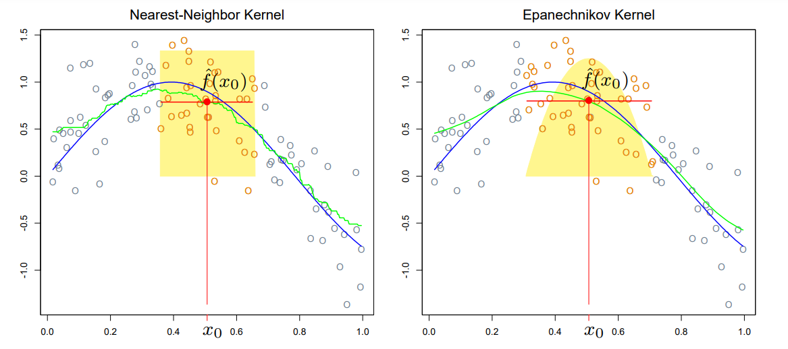
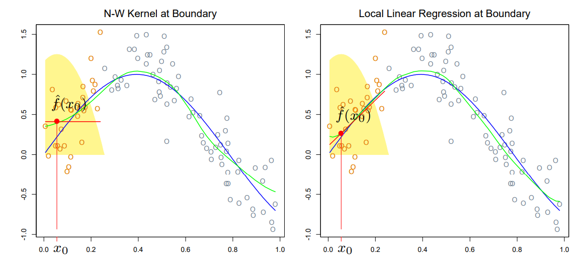

## Outline for today

* More on density estimation
    + non-Gaussian kernels
    + multivariate KDE
    + mixture models
* Scatterplot smoothing
    + Kernel smoothing
    + LOESS

```{r}
#| echo: false
#| output: false
library(tidyverse)
library(KernSmooth)
library(MASS)
library(locfit)
library(mclust)
```

## Sustainability Data
```{r, echo=FALSE}
sust <- read_csv('data/sustainability.csv')
```

```{r}
ggplot() +
  geom_point(data = sust, aes(x = Econ_Domain, y = Env_Domain), alpha = 0.5, size=1/2) +
  theme_minimal()
```


## Mixture models

KDE is a *nonparametric* technique: no population parameters are specified.

Mixture models are a parametric alternative for density estimation. The Gaussian mixture model is: 
$$
f(x) = a_1 \varphi(x; \mu_1, \sigma_1) + \cdots + a_n \varphi(x; \mu_n, \sigma_n)
$$

* $f(x)$ is the distribution of interest
* $\varphi(\cdot; \mu, \sigma)$ denotes a Gaussian density with mean $\mu$ and standard deviation $\sigma$
* the model has $n$ components
* $a_1, \dots, a_n$ are the mixing parameters 
* fitted using the EM algorithm

## Bivariate mixture model

Let's fit a mixture to the joint distribution of environmental and economic sustainability indices:
```{r}
# Fit Gaussian Mixture Model
gmm_fit <- Mclust(sust[, c("Env_Domain", "Econ_Domain")], 
                  G = 2, modelNames = "VVV") # Number of clusters
```

We can inspect the estimated components' centers (means):

```{r}
# Extract centers
centers <- gmm_fit$parameters$mean
centers
```

And the mixing parameters:

```{r}
mixing_params <- gmm_fit$parameters$pro
mixing_params
```

## Bivariate mixture model

```{r}
library(mvtnorm)
# Calculate GMM density
# Create grid for contour plotting

x_grid <- seq(min(sust$Env_Domain), max(sust$Env_Domain), length.out = 100)
y_grid <- seq(min(sust$Econ_Domain), max(sust$Econ_Domain), length.out = 100)
grid_points <- expand.grid(x = x_grid, y = y_grid)

l1 <- gmm_fit$parameters$variance$cholsigma[, , 1]
l2 <- gmm_fit$parameters$variance$cholsigma[,, 2]
sigma1 <- l1 %*% t(l1)
sigma2 <- l2 %*% t(l2)

component1_fn <- function(x) dmvnorm(x, mean = centers[, 1], 
                                   sigma = sigma1)
component2_fn <- function(x) dmvnorm(x, mean = centers[, 2],
                                   sigma = sigma2)

# Combined density function
density_fn <- function(x) {
 mixing_params[1] * component1_fn(x) + mixing_params[2] * component2_fn(x)
}

z <- density_fn(grid_points)
```

## Bivariate mixture model

```{r}
#| output-location: slide
ggplot() +
  # Add contours
  geom_contour(data = tibble(x=grid_points$x, y=grid_points$y, 
                             z=mixing_params[1]*component1_fn(grid_points)),
               aes(x = x, y = y, z = z)) +
  geom_contour(data = tibble(x=grid_points$x, y=grid_points$y, 
                             z=mixing_params[1]*component2_fn(grid_points)),
               aes(x = x, y = y, z = z)) +
  # Add original data points
  geom_point(data = sust, aes(x = Env_Domain, y = Econ_Domain), alpha = 0.5) +
  theme_minimal()
```

## Bivariate mixture model
```{r}
#| output-location: slide
# Create the plot
ggplot() +
  # Add contours
  geom_contour(data = tibble(x=grid_points$x, y=grid_points$y, z=z),
               aes(x = x, y = y, z = z)) +
  # Add original data points
  geom_point(data = sust, aes(x = Env_Domain, y = Econ_Domain), alpha = 0.5) +
  theme_minimal()


  

```
## Pros and Cons

KDE is a nonparametric method and is sometimes called a *memory-based* procedure: it uses all available data every time an estimated value is calculated.

* Advantages: minimal assumptions, highly flexible
* Disadvantages: not parsimonious, computationally intensive

GMM's are *parametric* models.

* Advantages: closed-form structure, good for multimodal distributions, various kinds of inference and prediction are possible
* Disadvantages: estimation is less straightforward, may over-smooth, possible identifiability issues

## GMMs for capturing subpopulations

The GMM is especially useful if there are latent subpopulations in the data. Recall the simulated population of hawks:

```{r}
# Hawks example
# Simulate data
set.seed(40721)
female_hawks <- tibble(
  length = rnorm(3000, mean = 57.5, sd = 3),
  sex = "female"
)
male_hawks <- tibble(
  length = rnorm(2000, mean = 50.5, sd = 3),
  sex = "male"
)
population_hawks <- bind_rows(female_hawks, male_hawks)
```

. . .

Let's imagine we have a sample but without recorded sexes.

```{r}
# Sample without sex information
set.seed(50223)
samp <- population_hawks %>%
  sample_n(500) %>%
  dplyr::select(-sex)


```

## Hawks

The histogram is not obviously bimodal, but we can suppose we're aware of the sex differences in length and just don't have that information.

```{r}
ggplot(samp, aes(x = length)) +
 geom_histogram(aes(y = after_stat(density)), 
               binwidth = 2,
               size = 20) + 
  theme_bw(base_size=16)
```

## Recovering subpopulations

If we fit a mixture model with two components, amazingly, the mixture components accurately recover the distributions for each sex, even though this was a latent (unobserved) variable:

```{r}
gmm_hawks <- Mclust(samp$length, G = 2)
```
```{r, echo=FALSE}
# Compare components with subpopulations
cat("gmm component means:", gmm_hawks$parameters$mean, "\n")
cat("true population means by sex:", sort(tapply(population_hawks$length, population_hawks$sex, mean)), "\n")
cat("------------------------------------------------\n")
cat("gmm component variances:", gmm_hawks$parameters$variance$sigmasq, "\n") 
cat("population variances by sex:", sort(tapply(population_hawks$length, population_hawks$sex, var)), "\n")
```

Note that the means and variances are estimated from the sample but compared with the population values above.

## GMM density estimate

Further, the density estimate fits reasonably well:

```{r}
#| output-location: slide
x <- seq(min(samp$length), max(samp$length), length.out = 100)
# Define component density functions
p1 <- gmm_hawks$parameters$pro[1]
p2 <- 1-p1

component1_fn <- function(x) dnorm(x, mean = gmm_hawks$parameters$mean[1], 
                                   sd = sqrt(gmm_hawks$parameters$variance$sigmasq[1]))
component2_fn <- function(x) dnorm(x, mean = gmm_hawks$parameters$mean[2], 
                                   sd = sqrt(gmm_hawks$parameters$variance$sigmasq[2]))

# Combined density function
density_fn <- function(x) {
 p1 * component1_fn(x) + p2 * component2_fn(x)
}

samp |> ggplot() + 
  geom_histogram(aes(x=length, 
                     y = after_stat(density)),
                 bins=30,
                 alpha=0.5) +
  stat_function(fun = density_fn, col="dark green", size=1.2) + 
  stat_function(fun = \(x) p1*component1_fn(x), size=1.2, col="red") +
  stat_function(fun = \(x) p2*component2_fn(x), size=1.2, col="blue") +
  xlim(c(40, 75)) + theme_minimal()
```

## Kernel smoothing

Kernel smoothing is a technique similar to KDE used to visualize and estimate *relationships* (rather than distributions). 

We'll use the GDP and life expectancy data to illustrate.

```{r}
#| output-location: slide
# Life expectancy data
life <- read_csv('data/life-gdp.csv') |>
  filter(Year == 2000) |>
  dplyr::select(`Country Name`, All, `GDP per capita`) %>%
  mutate(log_gdp = log(`GDP per capita`),
         life_exp = All) %>%
  dplyr::select(country = `Country Name`, log_gdp, life_exp)

# Kernel smoothing
ksmooth_fit <- ksmooth(life$log_gdp, life$life_exp, 
                      kernel = "normal", 
                      bandwidth = 1)

life |> ggplot() + geom_point(aes(x=log_gdp, y=life_exp)) + 
  geom_line(aes(x=x, y=y), data=as_tibble(ksmooth_fit), col="red", size=1.2) + 
  theme_bw(base_size=16)
```

## The method

The technique consists in estimating trend by local weighted averaging; a kernel function is used to determine the exact weights.

$$
\hat{y}(x) = \frac{\sum_i K_b (x_i - x) y_i}{\sum_i K_b(x_i - x)}
$$

{width=800}

Notice that the kernel smooth trails off a bit near the boundary -- this is because fewer points are being averaged once the smoothing window begins to extend beyond the range of the data.

## LOESS

Locally weighted scatterplot smoothing (LOESS or LOWESS) largely corrects this issue by stitching together lines (or low-order polynomials) fitted to local subsets of data; this way, near the boundary, the estimate still takes account of any trend present in the data.



## LOESS example

```{r}
#| output-location: slide
# Fit LOESS smooth
loess_fit <- loess(life_exp ~ log_gdp, data = life, span = 0.3)

# Create prediction grid
gdp_grid <- tibble(log_gdp = seq(min(life$log_gdp), max(life$log_gdp), length.out = 100))
loess_df <- tibble(log_gdp = gdp_grid$log_gdp,
                   life_exp_pred = predict(loess_fit, newdata = gdp_grid))


# Create plot
life_exp_smooth <- 
  ggplot() +
  geom_point(data = life, aes(x = log_gdp, y = life_exp)) +
  geom_line(data = loess_df, aes(x = log_gdp, y = life_exp_pred),
           color = "blue", size=1.2) +
  theme_bw(base_size=16)
life_exp_smooth
```

## LOESS example

This methodology is built into the `geom_smooth` function:

```{r}

ksmooth_fit <- ksmooth(life$log_gdp, life$life_exp, 
                      kernel = "normal", 
                      bandwidth = 1)

life |> ggplot(aes(x=log_gdp, y=life_exp)) + 
  geom_point() + 
  geom_smooth(method="loess", span=0.3, se=FALSE) + 
  geom_line(aes(x=x, y=y), data=as_tibble(ksmooth_fit), col="red", size=1.2) +
  theme_bw(base_size=16)
```

## LOESS example

This methodology is built into the `geom_smooth` function:

```{r}
life2 <- life |> filter(log_gdp > 8.5 | log_gdp < 7)
ksmooth_fit <- ksmooth(life2$log_gdp, life2$life_exp, 
                      kernel = "normal", 
                      bandwidth = 1)

life2 |> ggplot(aes(x=log_gdp, y=life_exp)) + 
  geom_point() + 
  geom_smooth(method="loess", span=0.3, se=FALSE) + 
  geom_line(aes(x=x, y=y), data=as_tibble(ksmooth_fit), col="red", size=1.2) +
  theme_bw(base_size=16)
```
## Example: Wavy Turban's at the beach

<center></center>

## Example: Wavy Turban's at the beach
```{r}
wt <- read_csv('data/wavy_turban_data.csv')

wt
```

## Spatial Map of Wavy Turbans
```{r}
#| output-location: slide
library(maps)

california <- map_data("state") %>%
  subset(region == "california")

ggplot() +
  geom_polygon(data = california, 
               aes(x = long, y = lat, group = group),
               fill = "white", 
               color = "black") +
  geom_point(data = wt |> filter(longitude < -115 & longitude > -125,
                               latitude < 45 & latitude > 32.5,
                               observed_on >= "2015-01-01"),
             aes(x = longitude, y = latitude),
             col = "red",
             size = 0.5,
             alpha = 0.6,
             bins=100) +
  # Set the coordinate system
  coord_map() +
  # Customize the theme
  theme_minimal() +
  # Add labels
  labs(title = "Wavy Turban Observations",
       x = "Longitude",
       y = "Latitude") +
  coord_cartesian(ylim=c(32.5, 36))
```

## Counts by month and year
```{r}
count_data <- wt |> mutate(date = ymd(observed_on), 
             month = month(date), 
             year = year(date)) |> 
  group_by(month, year) |> 
  summarize(count = n()) |> 
  mutate(date = ymd(paste(year, month, "1", sep="-"))) |> 
  arrange(date) |> filter(year > 2015)
print(count_data, n=10)
```


## Wavy Turban counts on iNaturalist

```{r}
count_data |>
  ggplot(aes(x=date, y=count)) + 
  geom_line() + theme_bw(base_size=16)
```

## Smoothing Wavy Turban Counts


```{r}
predictions <- loess(count ~ as.numeric(date), data=count_data) |> predict()

count_data$preds <- predictions

count_data |>
  ggplot(aes(x=date, y=count)) + 
  geom_line() + 
  geom_line(aes(y=preds), col="red", size=1.2) + theme_bw(base_size=16) 
```
## Residuals

```{r}
count_data$residual <- count_data$count - count_data$preds

count_data |>
  ggplot(aes(x=date, y=residual)) + 
  geom_line() + 
  theme_bw(base_size=16)
```

## Percent Change

```{r}
count_data$pct_change <- 100 * (count_data$count / count_data$preds) - 100

count_data |>
  ggplot(aes(x=date, y=pct_change)) + 
  geom_line() + 
  geom_hline(yintercept=0, linetype="dashed") +
  theme_bw(base_size=16)
```
## Median Percent Change by Month
```{r}
count_data |> group_by(month) |>
  summarize(pct_change = median(pct_change)) |>
  ggplot() + geom_line(aes(x=month, y=pct_change)) + 
  theme_bw(base_size=16) + 
  geom_hline(yintercept=0, linetype="dashed")
```

## Percent Change by Month

```{r}
count_data |> 
  ggplot() + 
  ggdist::stat_dist_interval(aes(x=month, y=pct_change)) +
  theme_bw(base_size=16) + 
  geom_hline(yintercept=0, linetype="dashed")
```
## Median Percent Change by Month 

```{r}
count_data |> ggplot(aes(x=month, y=pct_change)) + 
  geom_point() +
  geom_smooth(se=FALSE, col="blue") + theme_bw(base_size=16)
```


## Median Percent Change by Month 

Smooth again!

```{r}
count_data |> ggplot(aes(x=month, y=pct_change)) + 
  geom_smooth(se=FALSE, col="blue") + theme_bw(base_size=16) + 
  geom_point(aes(x=month, y=mean_pct_change), count_data |> group_by(month) |> summarize(mean_pct_change = mean(pct_change))) +
  geom_hline(yintercept = 0, linetype="dashed")
```


