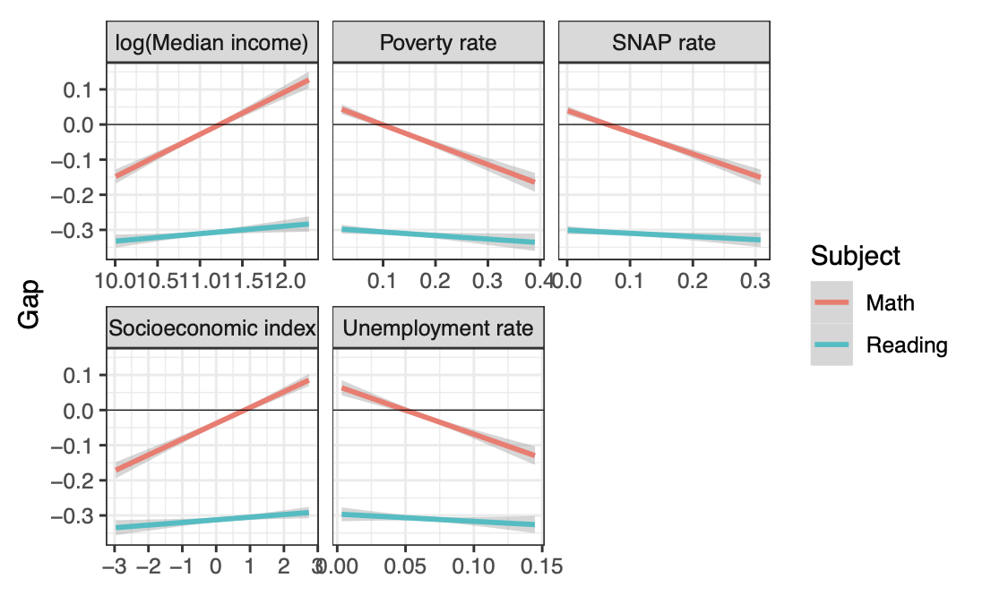
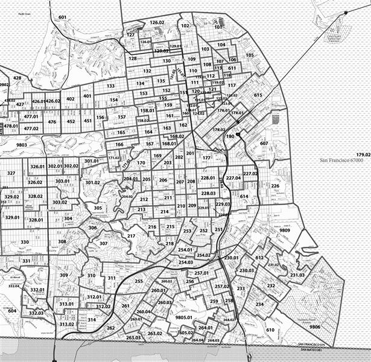
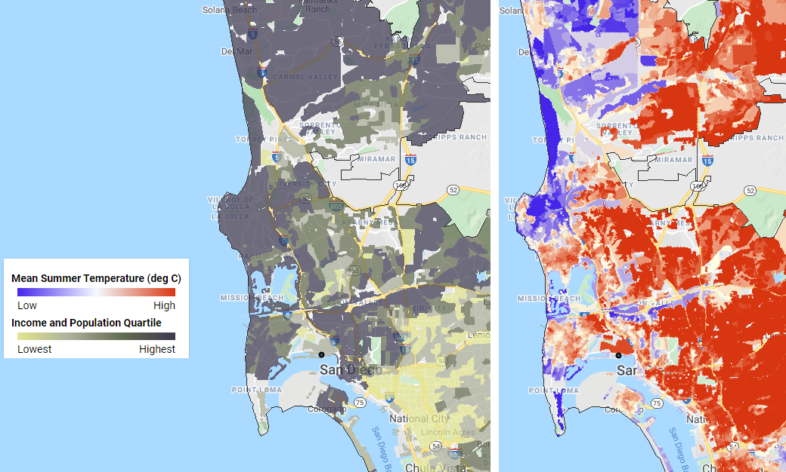
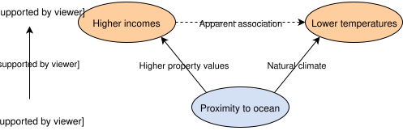

```{r, echo = FALSE}
rm(list = ls())
library(tidyverse)
library(gt)
theme_set(theme_bw(base_size = 16))

# colors shared with the bootstrap lecture
pop_col  <- "#D9A43B" # population / truth
boot_col <- "#047C91" # bootstrap
est_col  <- "#6D7D33" # estimates computed from a sample
hist_col <- "#C9BF9D"
```


# Why linear models?

## Recall: kernel smoothing

In the smoothing lecture we predicted life expectancy from (log) GDP per capita with a kernel smoother.

```{r}
life <- read_csv("data/life-gdp.csv") |>
  filter(Year == 2000) |>
  select(country = `Country Name`, life_exp = All, gdp = `GDP per capita`) |>
  mutate(log_gdp = log2(gdp))

b_cv <- 1.1 # bandwidth chosen by leave-one-out cross-validation in the smoothing lecture
ks_fit <- ksmooth(life$log_gdp, life$life_exp, kernel = "normal", bandwidth = b_cv)
```

```{r, echo = FALSE}
#| fig-width: 10
#| fig-height: 5
life |>
  ggplot(aes(x = log_gdp, y = life_exp)) +
  geom_point(alpha = 0.5) +
  geom_line(aes(x = x, y = y), data = as_tibble(ks_fit), color = "red", linewidth = 1.2) +
  labs(x = "log GDP per capita", y = "Life expectancy (years)")
```

To predict at $x$, we take a weighted average of the life expectancies of countries with GDP near $x$. There are no assumptions about the shape of the curve.

## Least squares lines

Now add the **least squares line** (we'll define it shortly):

```{r, echo = FALSE}
#| fig-width: 10
#| fig-height: 5
life_fit <- lm(life_exp ~ log_gdp, data = life)

life |>
  ggplot(aes(x = log_gdp, y = life_exp)) +
  geom_point(alpha = 0.5) +
  geom_line(aes(x = x, y = y, color = "kernel smoother"), data = as_tibble(ks_fit), linewidth = 1.2) +
  geom_abline(aes(intercept = coef(life_fit)[1], slope = coef(life_fit)[2],
                  color = "least squares line"), linewidth = 1.2) +
  scale_color_manual(values = c("kernel smoother" = "red", "least squares line" = "blue")) +
  labs(x = "log GDP per capita", y = "Life expectancy (years)", color = NULL) +
  theme(legend.position = "top")
```

The line is described by just two numbers, an intercept and a slope:

```{r}
coef(lm(life_exp ~ log_gdp, data = life))
```

## Which one predicts better?

We can use leave-one-out cross-validation to decide which method is better.

```{r}
loo_kernel <- numeric(nrow(life))
loo_line <- numeric(nrow(life))

for (i in 1:nrow(life)) {
  train <- life[-i, ]
  test <- life[i, ]
  loo_kernel[i] <- ksmooth(train$log_gdp, train$life_exp, kernel = "normal",
                           bandwidth = b_cv, x.points = test$log_gdp)$y
  loo_line[i] <- predict(lm(life_exp ~ log_gdp, data = train), newdata = test)
}

cv_results <- tibble(method = c("kernel smoother", "straight line"),
                     cv_rmse = c(sqrt(mean((life$life_exp - loo_kernel)^2)),
                                 sqrt(mean((life$life_exp - loo_line)^2))))
cv_results
```

Kernel smoothing is a little better: the trend flattens out for rich countries, and the straight line can't capture that. But the error is only slightly worse, with the average prediction error `r round(diff(cv_results$cv_rmse), 1)` years larger.

## So why linear models?

Linear models are the most widely used tool in statistics. Some reasons:

. . .

1. **A one-number summary.** "How much longer do people live in richer countries?" Each doubling of GDP per capita increases the life expectancy by `r round(coef(life_fit)[2] * log(2), 1)` more years of life expectancy, on average. A smooth curve has no single number to report.

. . .

2. **Many predictor variables.** A kernel smoother needs neighbors that are close for every predictor variable. With several variables, that breaks down quickly (we only showed smoothers with one predictor).

. . .

3. **Adjusting for other variables.** "Comparing countries with the *same GDP*, how is health expenditure related to life expectancy?" A linear model answers this directly.

. . .

4. **Stability.** A line is actually a very rigid smoother. It may have some bias, but it has low variance. (Recall the bias–variance tradeoff.)

. . .

5. **Uncertainty.** It is straightforward to put a standard error and a confidence interval on a slope.

6. **Foundational** The theory of linear models sets the foundation for more sophisticated methods.

<!-- ## The curse of dimensionality -->

<!-- Suppose each variable is spread evenly over its range, and the kernel window covers 20% of the range of each variable. With $n = 2000$ observations, how many neighbors fall in the window? -->

<!-- ```{r} -->
<!-- tibble(n_variables = c(1, 2, 3, 5, 10), -->
<!--        fraction_in_window = 0.2^n_variables, -->
<!--        expected_neighbors = 2000 * 0.2^n_variables) -->
<!-- ``` -->

<!-- With 5 variables the window is usually empty. To keep enough neighbors, the window must grow so wide that it is no longer "local". -->

<!-- . . . -->

<!-- A linear model avoids this by assuming a simple shape: each variable moves the prediction up or down by a fixed amount per unit. It uses *all* the data to estimate each of those amounts. -->

## Goals of modeling

Models serve three main purposes:

- **Description**: summarize the observed data (e.g., a slope).

- **Inference**: draw conclusions about a larger population than the observed data (e.g., a confidence interval for the slope).

- **Prediction**: predict the response for new units before it is observed.

. . .

Kernel smoothing is mostly a prediction (and visualization) tool. Linear models do all three.

# Least squares

## A familiar example

In HW2 you made this plot with `geom_smooth(method = "lm")`:

<center>{width="55%"}</center>

What is `lm` actually computing? And what do the gray bands mean?

## The SEDA data

```{r}
seda <- read_csv("data/seda.csv")

regdata <- seda |>
  filter(subject == "math") |>
  drop_na() |>
  select(-subject)

head(regdata, 3)
nrow(regdata)
```

- Each row is a California school district.
- `log_income`: log of the district's median household income.
- `gap`: average math score of boys minus girls, in standard deviations of the national average. Positive values favor boys.

## The data as pairs

```{r, echo = FALSE}
#| fig-width: 10
#| fig-height: 5
regdata |>
  ggplot(aes(x = log_income, y = gap)) +
  geom_point(shape = 1) +
  theme_bw(base_size=16) +
  labs(x = "log median income", y = "math gap (boys - girls)")
```

The data are $n = `r nrow(regdata)`$ pairs, one per district: $(x_1, y_1), \dots, (x_n, y_n)$, where $x$ is log income and $y$ is the gap.

## Lines and residuals

A line has an intercept $b_0$ and a slope $b_1$: $\;y = b_0 + b_1 x$.

The points never fall exactly on a line. But we can always write each $y_i$ as a point on the line plus a **residual**:

$$y_i = \underbrace{b_0 + b_1 x_i}_\text{line} + \underbrace{e_i}_\text{residual}$$

```{r, echo = FALSE}
#| fig-width: 10
#| fig-height: 4.5
slr <- lm(gap ~ log_income, data = regdata)

regdata |>
  ggplot(aes(x = log_income, y = gap)) +
  geom_segment(aes(xend = log_income, yend = fitted(slr)), color = "gray60", alpha = 0.6) +
  geom_point(shape = 1) +
  geom_abline(intercept = coef(slr)[1], slope = coef(slr)[2], color = "red", linewidth = 1) +
  labs(x = "log median income", y = "math gap (boys - girls)")
```

Each residual (gray) is the vertical distance from a point to the line: $e_i = y_i - (b_0 + b_1 x_i)$.

## Which line is best?

Every choice of $b_0, b_1$ gives a different set of residuals. Here are three candidates, with the **sum of squared residuals** (SSR) for each:

```{r, echo = FALSE}
#| fig-width: 13
#| fig-height: 5
candidates <- tibble(
  line = c("A: flat, at the average gap", "B: 50% steeper than C", "C: least squares"),
  b1 = c(0, 1.5 * coef(slr)[2], coef(slr)[2]),
  b0 = mean(regdata$gap) - b1 * mean(regdata$log_income)
) |>
  mutate(ssr = map2_dbl(b0, b1, \(a, b) sum((regdata$gap - a - b * regdata$log_income)^2)),
         label = paste0(line, "\nSSR = ", round(ssr, 2)))

candidates |>
  cross_join(regdata) |>
  mutate(on_line = b0 + b1 * log_income) |>
  ggplot(aes(x = log_income, y = gap)) +
  geom_segment(aes(xend = log_income, yend = on_line), color = "gray60", alpha = 0.6) +
  geom_point(shape = 1, alpha = 0.6) +
  geom_abline(aes(intercept = b0, slope = b1), data = candidates, color = "red", linewidth = 1) +
  facet_wrap(~ label) +
  labs(x = "log median income", y = "math gap")
```

## The least squares line

Choose the intercept and slope that make the sum of squared residuals as small as possible:

$$\text{SSR}(b_0, b_1) = \sum_{i=1}^n \big(y_i - b_0 - b_1 x_i\big)^2$$

The minimizers, written $\hat\beta_0$ and $\hat\beta_1$, give the **least squares line** (also called *ordinary least squares*, or OLS).

. . .

- By squaring the residuals, we try to avoid lines with big outliers.

- Least squares is just a rule for summarizing a scatterplot with a line. We'll bring in randomness later, to quantify uncertainty.

## A familiar special case: the mean

With no $x$ at all, the best constant $c$ minimizes $\sum_i (y_i - c)^2$. The answer is the sample mean:

```{r}
ssr_constant <- function(c) sum((regdata$gap - c)^2)
optimize(ssr_constant, interval = c(-1, 1))$minimum
mean(regdata$gap)
```

. . .

So the least squares line extends the mean: instead of one average, it gives an average that changes (linearly) with $x$.

Kernel smoothing was a *local* average. Least squares fits one *global* line.

## Computing the least squares line in R

```{r}
slr <- lm(gap ~ log_income, data = regdata)
coef(slr)
```

. . .

Check: minimize the SSR directly with a general-purpose optimizer.

```{r}
ssr <- function(b) sum((regdata$gap - b[1] - b[2] * regdata$log_income)^2)
optim(c(0, 0), ssr, method = "BFGS")$par
```

Same answer. `lm` doesn't search: there is an exact formula for the minimizer (see the [optional appendix](#least-squares-formula) or PSTAT 126).

## Terminology

$$y_i = \hat\beta_0 + \hat\beta_1 x_i + e_i$$

- $y$ is the **response** variable (here, the gap).

- $x$ is the **explanatory** variable (also called a *predictor* or *feature*; here, log income).

- $\hat\beta_0, \hat\beta_1$ are the estimated **coefficients**: the intercept and the slope.

- $\hat y_i = \hat\beta_0 + \hat\beta_1 x_i$ is the **fitted value** for unit $i$: the point on the line.

- $e_i = y_i - \hat y_i$ is the **residual** for unit $i$.

## Fitted values and residuals

```{r}
regdata <- regdata |>
  mutate(fitted = fitted(slr),
         residual = resid(slr)) # same as gap - fitted

head(regdata, 3)
```

. . .

Two properties of least squares residuals:

```{r}
mean(regdata$residual)                     # residuals average to zero
cor(regdata$residual, regdata$log_income)  # and are uncorrelated with x
```

The line has used up all the *linear* information in $x$. Any pattern left in the residuals is non-linear.

## Interpreting the slope

```{r}
coef(slr)
```

**Slope:** comparing two districts whose log median income differs by 1, the math gap is on average `r round(coef(slr)[2], 3)` higher (more in favor of boys) in the higher-income district.

. . .

A difference of 1 in log income is hard to picture. A difference of $\log 2 \approx 0.69$ is a *doubling* of income:

```{r}
coef(slr)[2] * log(2)
```

Comparing two districts where one has twice the median income of the other, the math gap is on average `r round(coef(slr)[2] * log(2), 3)` standard deviations more in favor of boys in the richer district.

## Interpreting the intercept

**Intercept:** the value of the line at $x = 0$, i.e., a median income of $e^0 = \$1$.

```{r}
range(exp(regdata$log_income))
```

The intercept is not meaningful by itself. It appropriately centers the line to run through the data.

## Interpreting Coefficients

**General templates:**

- (Intercept) At [$x = 0$], the line's value for [response] is [$\hat\beta_0$ units].

- (Slope) Comparing units that differ by [one unit of $x$], [response] is on average [$\hat\beta_1$ units] higher in the unit with the larger $x$.

These describe associations. They don't say what would happen if one district's income changed. We cannot make **causal** claims without more assumptions.

## Prediction

To predict for a district with median income \$86,000, plug in $x_{new} = \log(86000)$:

$$\hat y_{new} = \hat\beta_0 + \hat\beta_1 \log(86000)$$

```{r}
coef(slr)[1] + coef(slr)[2] * log(86000)

new_district <- tibble(log_income = log(86000))
predict(slr, newdata = new_district)
```

How much should we trust this number? What are we estimating and what is the uncertainty?

# What are we estimating?

## The line depends on the sample

If we had observed a different set of districts, we would get a different least squares line.

. . .

So the least squares line is an estimate (like a sample mean).  This means it has a sampling distribution.

. . .

| | Single variable | Regression |
|---|---|---|
| Population quantity (target) | population mean $\mu$ | population least squares line $\beta_0, \beta_1$ |
| Estimate from the sample | sample mean $\hat\mu$ | least squares line $\hat\beta_0, \hat\beta_1$ |

The **population least squares line** is the line we would get if we could fit least squares to the *entire population*.

## Even if the truth is curved

The population least squares line is the **best linear approximation** to the population. It is well defined whether or not the true relationship is a straight line.

```{r, echo = FALSE}
#| fig-width: 11
#| fig-height: 5.5
set.seed(2026)
N <- 20000
sim_pop <- tibble(x = runif(N, 0, 10)) |>
  mutate(avg = 20 * (1 - exp(-x / 3)),          # curved average
         y = avg + rnorm(N, sd = 1 + 0.4 * x))   # spread grows with x

pop_line <- coef(lm(y ~ x, data = sim_pop))

sample_lines <- map_dfr(1:20, \(s) {
  sim_sample <- slice_sample(sim_pop, n = 25)
  b <- coef(lm(y ~ x, data = sim_sample))
  tibble(b0 = b[1], b1 = b[2])
})

sim_pop |>
  slice_sample(n = 3000) |>
  ggplot(aes(x = x, y = y)) +
  geom_point(alpha = 0.15, color = "gray40", size = 0.8) +
  geom_abline(aes(intercept = b0, slope = b1), data = sample_lines,
              color = est_col, alpha = 0.6, linewidth = 0.6) +
  geom_line(aes(y = avg), linetype = "dashed", linewidth = 1) +
  geom_abline(intercept = pop_line[1], slope = pop_line[2], color = pop_col, linewidth = 2) +
  labs(title = "A simulated population: the average of y is curved, and the spread grows with x",
       subtitle = "dashed: true average  |  gold: population least squares line  |  green: lines from 20 samples of n = 25") +
  theme(plot.title = element_text(size = 15), plot.subtitle = element_text(size = 13))
```

The sample lines scatter around the gold line. The gold line is the target, even though no line describes the curve exactly.

## Assumption-lean regression

A general "assumption-lean" framework:

- **We assume** the units (rows) are a random sample of  $x$ and $y$ pairs from the population

- We **don't assume** that the true relationship is a straight line
- We **don't assume** that the spread around the line is the same at every $x$ (called "homoskedasticity" in 126)
- We **don't assume** that the residuals follow a bell curve (normal distribution).

## Assumption-lean regression

The **assumption-lean** regression (Berk, Buja, Brown, et al., "Assumption Lean Regression", *The American Statistician*, 2021) emphasizes the utility of linear models as an approximation to the truth.

Other courses (e.g., PSTAT 126) add the extra assumptions above and derive formulas for standard errors from them. We'll compute standard errors from the bootstrap instead.

<!-- ## When to be careful -->

<!-- The one assumption we keep still matters: -->

<!-- - **Sketchy sampling.** If units were not sampled at random, the population target is unclear, and the bootstrap cannot fix bias (recall the hawks: the bootstrap sees variability, not bias). -->

<!-- - **Very small samples.** With only a handful of units, the fitted line is unstable, and the bootstrap can be unreliable too. -->

<!-- . . . -->

<!-- For SEDA, the population is conceptual: think of these 625 districts as one draw of the districts and student cohorts that *could* have been tested. In the tree cover case study, we'll have an actual population to check our answers against. -->

## The Paired Bootstrap

The rule from the bootstrap lecture: **resample whole units (rows), so every variable that belongs to a unit stays with that unit.**

For regression, resample districts. Each district brings its $(x, y)$ pair with it. This is the **paired bootstrap**.

. . .

1. Resample $n$ districts with replacement.
2. Fit least squares to the bootstrap sample. Save the intercept and slope.
3. Repeat many times. The spread of the saved slopes estimates the standard error of $\hat\beta_1$.

## One bootstrap sample

```{r}
set.seed(100)
boot_districts <- regdata |> slice_sample(n = nrow(regdata), replace = TRUE)
coef(lm(gap ~ log_income, data = boot_districts))
coef(slr) # our estimate, for comparison
```

Some districts appear more than once and others not at all, so the line moves a little.

## The complete bootstrap

```{r}
set.seed(1)
n_bootstrap <- 2000
boot_coefs <- tibble(intercept = numeric(n_bootstrap),
                     slope = numeric(n_bootstrap))

for (rep_id in 1:n_bootstrap) {
  boot_districts <- regdata |> slice_sample(n = nrow(regdata), replace = TRUE)
  boot_fit <- lm(gap ~ log_income, data = boot_districts)
  boot_coefs$intercept[rep_id] <- coef(boot_fit)[1]
  boot_coefs$slope[rep_id] <- coef(boot_fit)[2]
}

head(boot_coefs)
```

## 50 bootstrap lines

```{r, echo = FALSE}
#| fig-width: 10
#| fig-height: 5.5
regdata |>
  ggplot(aes(x = log_income, y = gap)) +
  geom_point(shape = 1, alpha = 0.5) +
  geom_abline(aes(intercept = intercept, slope = slope), data = slice_head(boot_coefs, n = 50),
              color = boot_col, alpha = 0.3) +
  geom_abline(intercept = coef(slr)[1], slope = coef(slr)[2], color = est_col, linewidth = 1.2) +
  labs(x = "log median income", y = "math gap (boys - girls)")
```

Each teal line is the least squares line from one bootstrap sample; the green line is our estimate. The lines fan out at the edges, where there are fewer districts.

## Bootstrap distribution of the slope

```{r}
slope_se <- sd(boot_coefs$slope)
slope_ci <- quantile(boot_coefs$slope, probs = c(0.025, 0.975))
slope_se
slope_ci
```

```{r, echo = FALSE}
#| fig-width: 10
#| fig-height: 4.5
ggplot(boot_coefs, aes(x = slope)) +
  geom_histogram(bins = 40, fill = hist_col, color = "white") +
  geom_vline(xintercept = slope_ci, color = boot_col, linewidth = 1.5) +
  geom_vline(xintercept = coef(slr)[2], color = est_col, linewidth = 1.5) +
  labs(x = "bootstrap slope", y = "count")
```

We report: slope `r round(coef(slr)[2], 3)`, bootstrap standard error `r round(slope_se, 3)`, 95% CI [`r round(slope_ci[1], 3)`, `r round(slope_ci[2], 3)`].

## Was the income association a fluke?

The 95% confidence interval for the slope does not include 0. So we're confident the population slope is positive: in richer districts, the math gap tends to be more in favor of boys.

. . .

Per doubling of income, multiply by $\log 2$:

```{r}
slope_ci * log(2)
```

"We are 95% confident that, comparing two districts where one has twice the median income of the other, the average math gap is between `r round(slope_ci[1] * log(2), 3)` and `r round(slope_ci[2] * log(2), 3)` standard deviations more in favor of boys in the richer district."

## A common mistake: resampling $x$ and $y$ separately

What goes wrong here?

```{r}
set.seed(100)
boot_slopes_wrong <- numeric(n_bootstrap)

for (rep_id in 1:n_bootstrap) {
  x_star <- sample(regdata$log_income, replace = TRUE)
  y_star <- sample(regdata$gap, replace = TRUE)
  boot_slopes_wrong[rep_id] <- coef(lm(y_star ~ x_star))[2]
}

c(center = mean(boot_slopes_wrong), se = sd(boot_slopes_wrong))
```

. . .

Resampling $x$ and $y$ separately breaks up the pairs, so each bootstrap sample has *no relationship* between income and gap. The slopes center on 0 instead of on our estimate, `r round(coef(slr)[2], 3)`.

**Rule:** resample whole units, so each district's $x$ stays with its $y$.

## An uncertainty band for the line

At each income level, the 2.5% and 97.5% quantiles of the 2000 bootstrap lines give a band:

```{r}
income_grid <- tibble(log_income = seq(min(regdata$log_income), max(regdata$log_income),
                                       length.out = 100))

band <- expand_grid(boot_coefs, income_grid) |>
  mutate(on_line = intercept + slope * log_income) |>
  group_by(log_income) |>
  summarize(lower = quantile(on_line, 0.025),
            upper = quantile(on_line, 0.975))
```

```{r, echo = FALSE}
#| fig-width: 10
#| fig-height: 4.5
regdata |>
  ggplot(aes(x = log_income)) +
  geom_point(aes(y = gap), shape = 1, alpha = 0.4) +
  geom_ribbon(aes(ymin = lower, ymax = upper), data = band, fill = boot_col, alpha = 0.4) +
  geom_abline(intercept = coef(slr)[1], slope = coef(slr)[2], color = est_col, linewidth = 1.2) +
  labs(x = "log median income", y = "math gap (boys - girls)")
```

This is essentially the gray band that `geom_smooth(method = "lm")` drew in HW2.

## The band is for the line, not for districts

The band shows where the **population line** (the average gap at each income) plausibly lies. It says nothing about where individual districts fall.

```{r}
# the band's limits at each district's own income (approx() interpolates)
lower_i <- approx(band$log_income, band$lower, xout = regdata$log_income)$y
upper_i <- approx(band$log_income, band$upper, xout = regdata$log_income)$y

inside_band <- regdata$gap >= lower_i & regdata$gap <= upper_i
mean(inside_band) # fraction of districts inside the band
```

Only about `r round(100 * mean(inside_band))`% of districts fall inside it. (Compare: a CI for a median is not a range for 95% of the data.)

## Predicting a new district

For a district with median income \$86,000:

```{r}
x_new <- log(86000)
pred_new <- coef(slr)[1] + coef(slr)[2] * x_new

# the average gap among districts with this income: bootstrap the line's height
boot_pred_new <- boot_coefs$intercept + boot_coefs$slope * x_new
quantile(boot_pred_new, probs = c(0.025, 0.975))

# one individual district: add the typical spread of districts around the line
pred_new + quantile(regdata$residual, probs = c(0.025, 0.975))
```

. . .

- The **average** gap at \$86K is pinned down well.
- The range for an **individual** district is about `r round(diff(quantile(regdata$residual, c(0.025, 0.975))) / diff(quantile(boot_pred_new, c(0.025, 0.975))))` times wider.
- The second range assumes districts scatter around the line about equally at every income level. Check the scatterplot before trusting it.

## What about `summary(lm)`?

`summary()` prints a "Std. Error" for each coefficient:

```{r}
summary(slr)$coefficients
```

That column comes from a **formula** that assumes the spread around the line is the same at every $x$. The `t value` and `Pr(>|t|)` columns add a normal-distribution assumption.

. . .

```{r, echo = FALSE}
set.seed(4)
boot_life_slopes <- numeric(n_bootstrap)
for (rep_id in 1:n_bootstrap) {
  boot_countries <- life |> slice_sample(n = nrow(life), replace = TRUE)
  boot_life_slopes[rep_id] <- coef(lm(life_exp ~ log_gdp, data = boot_countries))[2]
}
```

```{r}
se_comparison <- tibble(
  data = c("SEDA: gap ~ log income", "Life expectancy: life_exp ~ log GDP"),
  formula_se = c(summary(slr)$coefficients[2, "Std. Error"],
                 summary(life_fit)$coefficients[2, "Std. Error"]),
  bootstrap_se = c(sd(boot_coefs$slope), sd(boot_life_slopes)))
se_comparison
```

For SEDA they roughly agree. For life expectancy the formula SE is about `r round(100 * (se_comparison$formula_se[2] / se_comparison$bootstrap_se[2] - 1))`% larger: the spread around the line is much larger among poor countries than rich ones, which breaks the formula's assumption. The paired bootstrap does not need it.

# Multiple linear regression

## More than one explanatory variable

The **linear model** with $p$ explanatory variables:

$$y_i = \beta_0 + \beta_1 x_{i1} + \beta_2 x_{i2} + \cdots + \beta_p x_{ip} + e_i$$

. . .

Everything carries over from one variable:

- **Fitting:** choose $\hat\beta_0, \dots, \hat\beta_p$ to minimize the sum of squared residuals $\sum_i e_i^2$.

- **Target:** the population least squares coefficients $\beta_0, \dots, \beta_p$ (the best linear approximation).

- **Uncertainty:** the paired bootstrap. Resample whole units and refit.

With two explanatory variables, the "line" becomes a plane; with more, a *hyperplane*.

## The linear model in matrix form

Stack the data so that each row is a unit and each column is a variable:

$$\underbrace{\left[\begin{array}{c} y_1 \\ y_2 \\ \vdots \\ y_n \end{array}\right]}_{\mathbf{y}}
  = \underbrace{\left[\begin{array}{cccc}
      1 & x_{11} & \cdots & x_{1p} \\
      1 & x_{21} & \cdots & x_{2p} \\
      \vdots & \vdots & \ddots & \vdots \\
      1 & x_{n1} & \cdots & x_{np}
      \end{array}\right]}_{\mathbf{X}}
    \underbrace{\left[\begin{array}{c} \beta_0 \\ \beta_1 \\ \vdots \\ \beta_p \end{array}\right]}_{\beta}
  + \underbrace{\left[\begin{array}{c} e_1 \\ e_2 \\ \vdots \\ e_n \end{array}\right]}_{\mathbf{e}}$$

- The column of 1s gives the intercept.
- Row $i$ of $\mathbf{X}\beta$ is $\beta_0 + \beta_1 x_{i1} + \cdots + \beta_p x_{ip}$, the model's value for unit $i$.
- In R, `model.matrix()` builds $\mathbf{X}$ for you. `lm()` builds it behind the scenes.

# Case study: urban tree cover

## Trees and urban heat

Tree canopy cools cities, through shade and evaporation from leaves. Urban forestry projects have been proposed as a way to adapt cities to a warming climate.

**Question:** in San Diego, how are summer temperatures associated with tree cover and income?

. . .

Data source: McDonald RI, Biswas T, Sachar C, Housman I, Boucher TM, Balk D, et al. (2021). The tree cover and temperature disparity in US urbanized areas: Quantifying the association with income across 5,723 communities. *PLoS ONE* 16(4): e0249715. [doi:10.1371/journal.pone.0249715](https://journals.plos.org/plosone/article?id=10.1371/journal.pone.0249715)

## The data

```{r}
trees_pop <- read_csv("data/utc-sd.csv") |>
  transmute(tree_cover = 100 * fc_in_BG_g, # stored as a fraction; convert to percent
            income = IncPr / 1000,         # mean income, in $1000s
            temp = SurfaceTem,             # mean summer surface temperature (°C)
            pop_density = factor(PopDensGrp, levels = 1:4,
                                 labels = c("very low", "low", "medium", "high"))) |>
  filter(temp > 0, income > 0)             # 0 and -99 are missing-value codes

nrow(trees_pop)
```

This is essentially every census block in the San Diego urban area: a **population**.

. . .

As with the hawks, we'll pretend we could only afford to study a **random sample** of 2000 blocks. Keeping the full population lets us check our answers.

```{r}
set.seed(51421)
trees <- trees_pop |> slice_sample(n = 2000)
head(trees, 4)
```

## Observational units

The units are **census blocks**: small areas, often about the size of a city block.

For a sense of scale, here are the census *tracts* in San Francisco. Each tract contains many blocks:

<center>{width="35%"}</center>

## Tree cover and summer temperature

```{r, echo = FALSE}
#| fig-width: 11
#| fig-height: 5.5
trees |>
  ggplot(aes(x = tree_cover, y = temp, color = income)) +
  geom_point(alpha = 0.6) +
  scale_color_gradientn(colors = rev(RColorBrewer::brewer.pal(11, "RdBu")), trans = "log",
                        breaks = c(10, 20, 40, 80, 160)) +
  labs(x = "Tree cover (%)", y = "Mean summer temperature (°C)",
       color = "Mean income\n($1000s)")
```

Leafier blocks tend to be cooler, and they also tend to be richer (blue).

## Model 1: tree cover and income

$$\text{temp}_i = \beta_0 + \beta_1\, \text{cover}_i + \beta_2\, \text{income}_i + e_i$$

```{r}
fit1 <- lm(temp ~ tree_cover + income, data = trees)
coef(fit1)
```

. . .

`lm()` built this $\mathbf{X}$ matrix and minimized the sum of squared residuals:

```{r}
model.matrix(fit1) |> head(4)
```

## Interpreting the coefficients

```{r}
coef(fit1)
```

- **Tree cover:** comparing census blocks with the *same mean income*, a block with 10 percentage points more tree cover is on average `r round(-10 * coef(fit1)["tree_cover"], 2)`°C cooler.

- **Income:** comparing census blocks with the *same tree cover*, a block with \$10,000 higher mean income is on average `r round(-10 * coef(fit1)["income"], 2)`°C cooler.

. . .

**General template:** comparing units that differ by one unit in $x_j$ but have the *same values of the other explanatory variables*, the response differs on average by $\hat\beta_j$.

We say the coefficient on tree cover is **adjusted for** income (or "controls for" income).

## What does adjusting do?

```{r}
coef(lm(temp ~ tree_cover, data = trees))          # tree cover alone
coef(lm(temp ~ tree_cover + income, data = trees)) # adjusting for income
cor(trees$tree_cover, trees$income)
```

. . .

- Tree cover alone: 10 percentage points more cover goes with `r round(-10 * coef(lm(temp ~ tree_cover, data = trees))[2], 2)`°C cooler, on average.
- Adjusting for income: `r round(-10 * coef(fit1)["tree_cover"], 2)`°C cooler.

Leafier blocks also tend to be richer, and richer blocks tend to be cooler. The simple regression credits trees with some of the cooling that goes with income. Multiple regression separates the two.

## How well does the model fit? $R^2$

$R^2$ is the **fraction of the variation in the response explained by the model**:

$$R^2 = 1 - \frac{\text{variance of the residuals}}{\text{variance of } y}$$

```{r}
1 - var(resid(fit1)) / var(trees$temp)
summary(fit1)$r.squared
```

. . .

About `r round(100 * summary(fit1)$r.squared)`% of the variation in summer temperatures across blocks is explained by tree cover and income. The rest is due to other local factors, such as distance to the ocean, elevation, and pavement.

A low $R^2$ does not make the coefficients wrong. It means the model leaves a lot of variation unexplained, so individual predictions will be imprecise.

## Paired bootstrap for multiple regression

The same algorithm as before, now saving every coefficient. We write it as a function so we can reuse it:

```{r}
paired_bootstrap <- function(formula, data, n_bootstrap = 2000) {
  boot_coefs <- vector("list", n_bootstrap)
  for (rep_id in 1:n_bootstrap) {
    # resample whole units (rows), then refit
    boot_data <- data |> slice_sample(n = nrow(data), replace = TRUE)
    boot_coefs[[rep_id]] <- coef(lm(formula, data = boot_data))
  }
  # one row per bootstrap sample, one column per coefficient
  do.call(rbind, boot_coefs)
}

summarize_boot <- function(fit, boot) {
  tibble(term = names(coef(fit)),
         estimate = coef(fit),
         boot_se = apply(boot, 2, sd),
         lower = apply(boot, 2, quantile, probs = 0.025),
         upper = apply(boot, 2, quantile, probs = 0.975))
}
```

## Model 1 with bootstrap uncertainty

```{r}
set.seed(2)
boot_fit1 <- paired_bootstrap(temp ~ tree_cover + income, trees)
head(boot_fit1, 3)
```

```{r}
summarize_boot(fit1, boot_fit1) |>
  gt() |>
  fmt_number(columns = -term, n_sigfig = 3) |>
  tab_header(title = "Bootstrap standard errors and 95% CIs")
```

Neither confidence interval for the slopes includes 0.

## Did the bootstrap get it right?

Here we have the whole population, so we can compute the **target** directly. We can also simulate the true sampling distribution by drawing 1000 new samples of 2000 blocks.

```{r}
pop_fit1 <- lm(temp ~ tree_cover + income, data = trees_pop)

set.seed(3)
n_simulation <- 1000
sim_fit1 <- matrix(NA, nrow = n_simulation, ncol = 3)
for (rep_id in 1:n_simulation) {
  sim_blocks <- trees_pop |> slice_sample(n = 2000) # a brand new study
  sim_fit1[rep_id, ] <- coef(lm(temp ~ tree_cover + income, data = sim_blocks))
}
```

. . .

```{r}
summarize_boot(fit1, boot_fit1) |>
  mutate(target = coef(pop_fit1),                # needs the population
         simulated_se = apply(sim_fit1, 2, sd),  # needs the population
         formula_se = summary(fit1)$coefficients[, "Std. Error"],
         ci_covers_target = lower <= target & target <= upper) |>
  select(term, target, estimate, simulated_se, boot_se, formula_se, ci_covers_target) |>
  gt() |>
  fmt_number(columns = -c(term, ci_covers_target), n_sigfig = 3)
```

## Did the bootstrap get it right?

```{r, echo = FALSE}
#| fig-width: 11
#| fig-height: 5
cover_dists <- bind_rows(
  tibble(value = sim_fit1[, 2], type = "simulation: new samples from the population"),
  tibble(value = boot_fit1[, "tree_cover"], type = "bootstrap: resamples of our one sample")
)

ggplot(cover_dists, aes(x = value, fill = type)) +
  geom_density(alpha = 0.5, color = NA) +
  geom_vline(xintercept = coef(pop_fit1)["tree_cover"], color = pop_col,
             linetype = "dashed", linewidth = 1.2) +
  geom_vline(xintercept = coef(fit1)["tree_cover"], color = est_col, linewidth = 1.2) +
  scale_fill_manual(values = c(pop_col, boot_col) |>
                      setNames(c("simulation: new samples from the population",
                                 "bootstrap: resamples of our one sample"))) +
  labs(x = "tree cover coefficient (°C per percentage point)", y = NULL, fill = NULL) +
  theme(legend.position = "top", axis.text.y = element_blank(), axis.ticks.y = element_blank())
```

- The simulated distribution centers on the target (dashed gold). The bootstrap distribution centers on our estimate (green).
- The two **spreads** are similar, so the bootstrap standard error is about right, from one sample alone.
- The formula SE is also close here: the spread around the plane is roughly constant in these data.

## Visualizing the fitted model

Fitted lines for three income levels (10th, 50th, and 90th percentiles), with 95% bootstrap bands:

```{r, echo = FALSE}
#| fig-width: 11
#| fig-height: 5.5
income_levels <- quantile(trees$income, probs = c(0.1, 0.5, 0.9))
income_labels <- paste0(c("10th", "50th", "90th"), " percentile: $", round(income_levels), "K")

boot_coefs1 <- as_tibble(boot_fit1, .name_repair = ~ c("b0", "b_cover", "b_income"))
grid <- expand_grid(tree_cover = seq(0, 40, by = 1), income = income_levels)

bands <- expand_grid(boot_coefs1, grid) |>
  mutate(on_plane = b0 + b_cover * tree_cover + b_income * income) |>
  group_by(tree_cover, income) |>
  summarize(lower = quantile(on_plane, 0.025), upper = quantile(on_plane, 0.975), .groups = "drop") |>
  mutate(fit = coef(fit1)[1] + coef(fit1)[2] * tree_cover + coef(fit1)[3] * income,
         income_level = factor(income, levels = income_levels, labels = income_labels))

ggplot(bands, aes(x = tree_cover, color = income_level, fill = income_level)) +
  geom_ribbon(aes(ymin = lower, ymax = upper), alpha = 0.3, color = NA) +
  geom_line(aes(y = fit), linewidth = 1) +
  scale_color_viridis_d(end = 0.8) +
  scale_fill_viridis_d(end = 0.8) +
  labs(x = "Tree cover (%)", y = "Mean summer temperature (°C)",
       color = "Mean income", fill = "Mean income")
```

- The bands show how much the *lines* could move with a different sample of blocks, not how much individual block temperatures vary.
- The lines are parallel: the model assumes the tree cover slope is the same at every income level.

## Explaining associations {.smaller}

Trees cool their surroundings through shade and evaporation. But why would *income* be associated with temperature, after adjusting for tree cover?

One possibility: property values are higher near the ocean, and temperatures are cooler near the ocean.

<center>{width="60%"}</center>

So income may partly be a proxy for distance to the ocean.

## Confounding

Proximity to the ocean is a **confounding variable**:

- it is associated with higher incomes (an explanatory variable);
- it is also associated with lower temperatures (the response);
- so it can produce an association between income and temperature, even if income itself does nothing to temperature.

<center>{width="80%"}</center>

Regression coefficients describe associations. Reading them causally requires ruling out confounders like this one.

## Adding a categorical variable

What if we also include population density, a categorical variable with four levels?

```{r}
trees |> count(pop_density)
```

. . .

We can't just add a term $\beta_3\, \text{density}_i$: the values of density are words.

$$\beta_3 \times \text{low} = \; ?$$

So we need to represent the categories with numbers.

## Indicator variables

Encode each level with an **indicator**: a variable that is 1 if a condition holds and 0 otherwise.

$$I(\text{density} = \text{low}) = \begin{cases} 1 & \text{if population density is low} \\ 0 & \text{otherwise}\end{cases}$$

`lm()` does this automatically for factors. Here is the $\mathbf{X}$ it builds:

```{r}
fit2 <- lm(temp ~ tree_cover + income + pop_density, data = trees)

model.matrix(fit2) |>
  as_tibble() |>
  mutate(pop_density = trees$pop_density, .before = 1) |>
  select(pop_density, starts_with("pop_density")) |> # just the density columns
  head(6)
```

There is no column for "very low". That level is the **reference level**: it is the case where all three indicators are 0.

## The model with indicators

$$\begin{aligned}
\text{temp}_i = \beta_0 &+ \beta_1\, \text{cover}_i + \beta_2\, \text{income}_i \\
  &+ \beta_3\, \text{low}_i + \beta_4\, \text{med}_i + \beta_5\, \text{high}_i + e_i
\end{aligned}$$

The effect is a **different intercept for each density level**, with the same slopes:

| Density | Intercept | Slopes |
|---|---|---|
| very low | $\beta_0$ | $\beta_1\, \text{cover} + \beta_2\, \text{income}$ |
| low | $\beta_0 + \beta_3$ | $\beta_1\, \text{cover} + \beta_2\, \text{income}$ |
| medium | $\beta_0 + \beta_4$ | $\beta_1\, \text{cover} + \beta_2\, \text{income}$ |
| high | $\beta_0 + \beta_5$ | $\beta_1\, \text{cover} + \beta_2\, \text{income}$ |

So $\beta_4$ is the average temperature difference between medium- and very-low-density blocks *with the same tree cover and income*.

## Model 2 with bootstrap uncertainty

```{r}
set.seed(5)
boot_fit2 <- paired_bootstrap(temp ~ tree_cover + income + pop_density, trees)

summarize_boot(fit2, boot_fit2) |>
  gt() |>
  fmt_number(columns = -term, n_sigfig = 3)
```

The tree cover and income coefficients barely change.

## Population density: a surprise

```{r, echo = FALSE}
#| fig-width: 10
#| fig-height: 3.5
summarize_boot(fit2, boot_fit2) |>
  filter(str_detect(term, "pop_density")) |>
  mutate(term = factor(str_remove(term, "pop_density"), levels = c("high", "medium", "low"))) |>
  ggplot(aes(x = estimate, y = term)) +
  geom_vline(xintercept = 0, linetype = "dashed") +
  geom_linerange(aes(xmin = lower, xmax = upper), color = boot_col, linewidth = 2) +
  geom_point(size = 3, color = est_col) +
  labs(x = "difference from very-low-density blocks (°C), same tree cover and income",
       y = "density")
```

Comparing blocks with the same tree cover and income, medium- and high-density blocks are on average about 0.3°C **cooler** than very-low-density blocks. But the raw averages go the other way:

```{r}
trees |>
  group_by(pop_density) |>
  summarize(mean_temp = mean(temp),
            mean_cover = mean(tree_cover),
            mean_income = mean(income))
```

. . .

Denser blocks are warmer on average, but they also have less tree cover and lower incomes, both of which go with higher temperatures. Once those are accounted for, the remaining association with density is slightly negative. (Perhaps dense neighborhoods are closer to the coast? These data can't tell us.)

Both statements are true. They answer different questions.

## Scope of inference

- The blocks are a **random sample** of San Diego census blocks, so the population least squares coefficients for *San Diego blocks* are the target. We even checked: the bootstrap intervals cover the population values.

- The results don't automatically carry over to other cities.

- The coefficients are **associations**, not causal effects. Planting trees in a block would not necessarily cool it by `r round(-10 * coef(fit1)["tree_cover"], 2)`°C per 10 percentage points. Confounders such as distance to the ocean could explain part of the association.

## Summary

- **Why linear models:** a kernel smoother predicts well with one variable, but a linear model gives one-number summaries, handles many variables, adjusts for other variables, and is stable.

- **Least squares:** choose the coefficients that minimize the sum of squared residuals. No probability is needed to fit the line.

- **Target:** the population least squares coefficients, i.e., the best linear approximation. We don't assume the truth is linear, that the spread is constant, or that residuals are normal. We do assume the units are a random sample.

- **Uncertainty:** the **paired bootstrap**. Resample whole units, refit, and use the spread of the coefficients for standard errors and percentile confidence intervals.

- **Interpretation:** "comparing units with the same values of the other variables, a one-unit difference in $x_j$ goes with an average difference of $\hat\beta_j$ in $y$." Associations, not causes.

- **Categorical variables** enter as indicators (one level is the reference). $R^2$ is the fraction of variation explained.

# Appendix {visibility="uncounted"}

## The least squares formula {#least-squares-formula visibility="uncounted"}

*Optional.* In matrix form, the sum of squared residuals for a candidate coefficient vector $\mathbf{b}$ is

$$\text{SSR}(\mathbf{b}) = (\mathbf{y} - \mathbf{X}\mathbf{b})'(\mathbf{y} - \mathbf{X}\mathbf{b}).$$

Setting the gradient with respect to $\mathbf{b}$ to zero gives $\mathbf{X}'\mathbf{X}\mathbf{b} = \mathbf{X}'\mathbf{y}$. So the minimizer is

$$\hat\beta = (\mathbf{X}'\mathbf{X})^{-1}\mathbf{X}'\mathbf{y}$$

as long as no column of $\mathbf{X}$ is a linear combination of the others. (This is why `lm` drops one indicator for a categorical variable: the four indicators would add up to the column of 1s.)

```{r}
X <- model.matrix(slr) # column of 1s and log_income
y <- regdata$gap
solve(t(X) %*% X) %*% t(X) %*% y
coef(slr)
```

## Formula-based standard errors {#formula-se visibility="uncounted"}

*Optional.* If the population relationship is exactly linear and the spread around the line is the same at every $x$ (with standard deviation $\sigma$), then the variances of the coefficient estimates are the diagonal of $\sigma^2(\mathbf{X}'\mathbf{X})^{-1}$.

Plugging in $\hat\sigma^2 = \text{SSR}/(n - p - 1)$ gives the "Std. Error" column of `summary(lm)`:

```{r}
n <- nrow(regdata)
sigma2_hat <- sum(resid(slr)^2) / (n - 2)
sqrt(diag(sigma2_hat * solve(t(X) %*% X)))
summary(slr)$coefficients[, "Std. Error"]
```

Adding the assumption that the errors are normally distributed gives the t-based p-values and `confint()` intervals. When these assumptions are doubtful, as for the life expectancy data, use the paired bootstrap.
